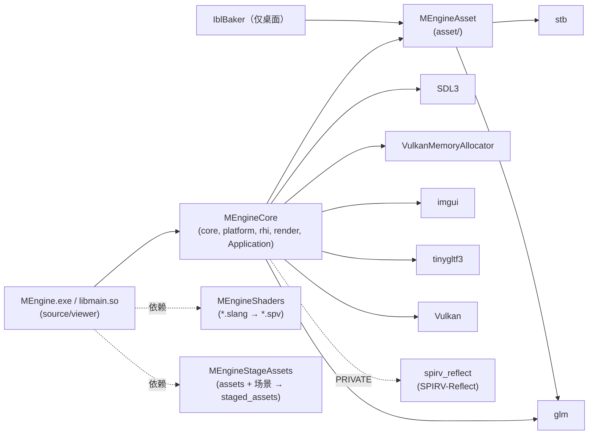
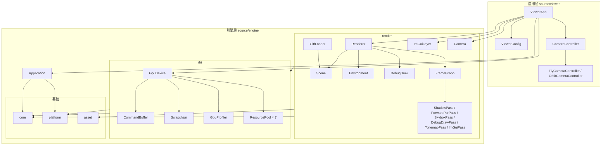
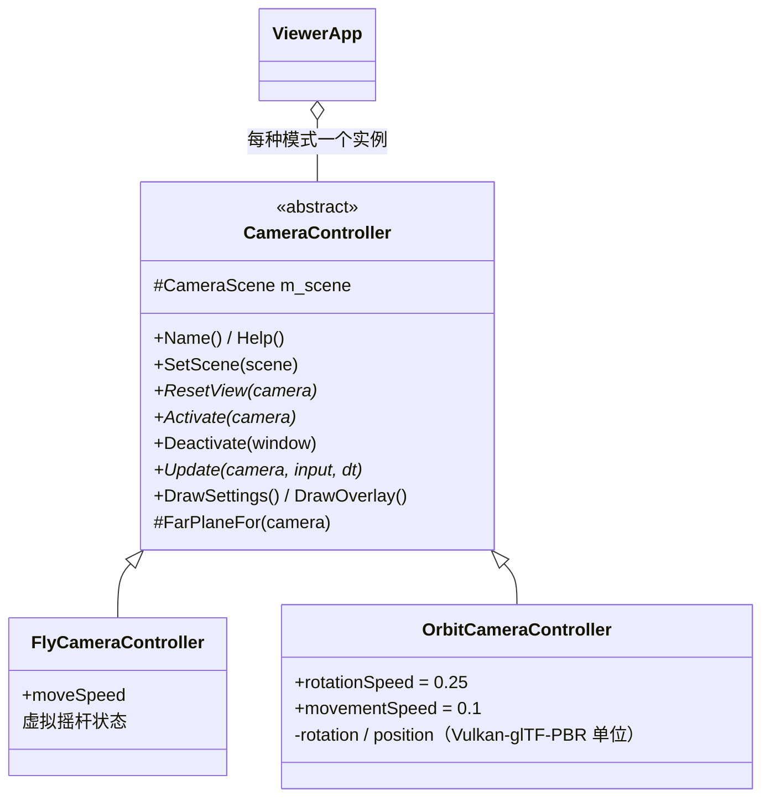
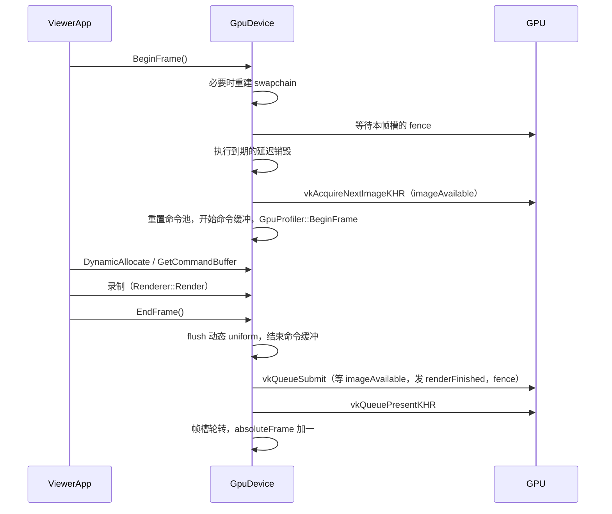
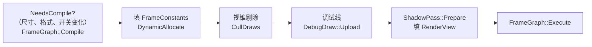
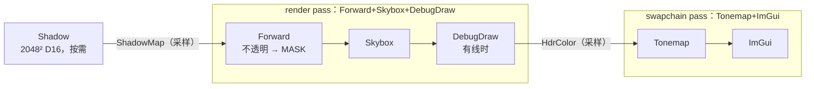
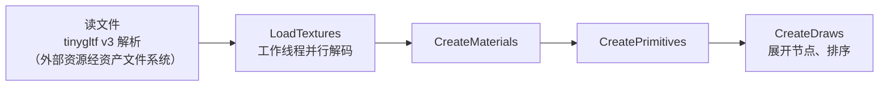
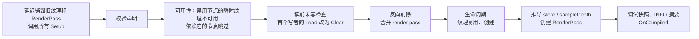
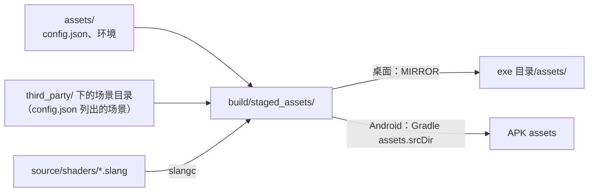

# MEngine 框架设计

本文按当前代码整理 MEngine 的整体架构：分层、各模块职责、一帧的执行流程、GPU 资源与同步模型、资源与着色器管线、平台差异，以及扩展方式。着色模型的公式与出处见 [`UE4-RealShading-2013.md`](UE4-RealShading-2013.md)，本文不重复。

## 0. 定位与约束

MEngine 是一个 glTF 2.0 PBR 查看器，同时运行在 Windows 桌面和 Android 上。RHI 的设计以 *Mastering Graphics Programming with Vulkan* 第 1 章的 Raptor 引擎为蓝本（Creation 描述 + 句柄 + 资源池，`GpuDevice` 为中心），着色严格按 UE4 2013 讲义。

所有设计决定都受下面几条硬约束支配：

| 约束 | 原因 | 对设计的影响 |
| --- | --- | --- |
| Vulkan 1.1，无 dynamic rendering | 目标手机不支持 1.2+ 和 `VK_KHR_dynamic_rendering` | 渲染一律走 `VkRenderPass` + `VkFramebuffer`；render pass 按输出格式缓存 |
| 只链接 Vulkan 1.0 符号 | Android API 24 的 `libvulkan.so` 只导出 1.0 入口 | VMA 用 `VMA_DYNAMIC_VULKAN_FUNCTIONS=1`；`vkEnumerateInstanceVersion` 运行时查找；特性只用 `vkGetPhysicalDeviceFeatures`（1.0） |
| SPIR-V 1.3 | Vulkan 1.1 能接受的最高版本 | `slangc -profile spirv_1_3` 离线编译 |
| 单一图形队列 | 手机通常只有一个队列族 | 上传、帧渲染、compute 都在同一个队列上提交 |
| 移动端 tile GPU | 带宽敏感 | 不需要保存的深度用 `STORE_OP_DONT_CARE`；前向渲染而非延迟渲染 |

## 1. 目录与构建目标

```
CMakeLists.txt                顶层构建，桌面与 Android 共用
cmake/                        StageAssets / CopyAssets（资源暂存）、CompileShaders（Slang）、GenerateShaderLayouts（布局校验）、ImGui、TinyGltf、SpirvReflect
source/engine/core            日志、断言、文件系统、JSON、计时、Handle、ResourcePool
source/engine/platform        SDL 窗口与输入
source/engine/asset           纯 CPU 资源解码：PNG/JPEG/HDR、KTX2 读写、BC7 软解（与 IblBaker 共用）
source/engine/rhi             GpuDevice、CommandBuffer、资源描述与池、Swapchain、GpuProfiler、ShaderReflection、PipelineCacheFile
source/engine/render          Renderer、Scene、GltfLoader、Environment、Camera、ImGuiLayer、DebugDraw、graph/（FrameGraph）、passes/
source/engine/Application.*   SDL main callbacks 之上的应用基类
source/viewer                 查看器：SDL 入口、ViewerApp、ViewerConfig、相机控制器（Fly / Orbit）
source/shaders                Slang 着色器，common/ 为共享头
programs/IblBaker             离线 IBL 烘焙工具（仅桌面）
assets/                       config.json、环境贴图等，打包进程序
android/                      Gradle 工程（SDL android-project 模板）
third_party/                  子模块：SDL、VMA、glm、imgui、stb、tinygltf、SPIRV-Reflect、示例资源
```

构建目标及其依赖：



- `MEngineAsset` 不依赖 Vulkan 头文件（KTX2 里的 VkFormat 用整数常量），所以离线工具可以复用。
- Android 上应用目标是共享库 `main`（SDLActivity 加载 `libmain.so`），桌面上是可执行文件 `MEngine`。
- Debug 和 RelWithDebInfo 定义 `MENGINE_ENABLE_VALIDATION_LAYERS`，开启校验层与 `VK_EXT_debug_utils`。

## 2. 分层



依赖规则：

- 自上而下单向依赖。`rhi` 不认识 `render` 的任何类型；`render` 不直接调用 Vulkan 的创建/销毁函数，只通过 `GpuDevice` 和 `CommandBuffer`（例外：`ImGuiLayer` 把设备句柄交给 imgui 官方 Vulkan 后端）。
- `ViewerApp` 是唯一同时持有 `GpuDevice`、`Renderer`、`ImGuiLayer` 的地方，负责把它们按顺序初始化和销毁。
- 命名空间：`mengine`（core、platform、Application、viewer）、`mengine::asset`、`mengine::rhi`、`mengine::render`。

## 3. 应用层

### 3.1 入口与生命周期

入口使用 SDL3 的 main callbacks（`SDL_MAIN_USE_CALLBACKS`），桌面和 Android 共用同一份 `viewer/main.cpp`：

| SDL 回调 | 转发到 | 说明 |
| --- | --- | --- |
| `SDL_AppInit` | `Application::Initialize` | `SDL_Init`、建窗口，再调 `OnInitialize` |
| `SDL_AppIterate` | `Application::Iterate` | 计时；挂起或最小化时只 `SDL_Delay(16)`；否则调 `OnFrame`，再 `Input::EndFrame` |
| `SDL_AppEvent` | `Application::HandleEvent` | 输入先进 `Input`；处理 Android 前后台切换（`OnSuspendChanged`）；再交给 `OnEvent` |
| `SDL_AppQuit` | `Application::Shutdown` | 调 `OnShutdown`，销毁窗口 |

`Application` 是抽象基类，持有 `Window`、`Input`、`FrameClock`。子类实现 `OnInitialize / OnShutdown / OnFrame`，可选 `OnEvent / OnSuspendChanged`。子类回调里抛出的异常在基类被捕获并记录，初始化或帧内的异常让程序以 `SDL_APP_FAILURE` 退出。

### 3.2 ViewerApp

`ViewerApp`（`viewer/ViewerApp.cpp`）是唯一的 `Application` 实现，成员按初始化顺序是 `GpuDevice → ImGuiLayer → Renderer`，销毁时先 `WaitIdle` 再逆序关闭。它负责：

- **配置**：启动时读 `config.json`（`LoadViewerConfig`），加载环境，再加载第一个场景。
- **场景切换**：ImGui 下拉框只记下 `m_pendingScene`；真正的 `LoadSceneAt` 在下一帧 `BeginFrame` 之前执行，因为加载需要等 GPU 空闲并释放旧场景。
- **相机与灯光复位**：每次换场景先把场景包围盒和 config 里的相机位姿交给所有相机控制器（`SetScene`），再让当前控制器回到它的默认视角（`ResetView`）；然后按相机位置重置点光源（让场景中心照度 E = 1）和方向光。
- **每帧**：当前 `CameraController::Update` → `GpuDevice::BeginFrame`（失败则跳过本帧）→ 构建 ImGui 面板 → `Renderer::Render` → `GpuDevice::EndFrame`。
- **面板**：场景切换、性能（FPS、管线统计、各节点 GPU 计时）、灯光、相机；Debug 面板开关视锥剔除及冻结、显示可见 / 总 draw 数，开关场景包围盒、阴影视锥和每个 draw 包围盒的调试线；Frame Graph 面板显示节点、render pass、资源生命周期，并切换节点开关和纹理复用（5.8）。
- **事件**：窗口尺寸变化时 `MarkSwapchainDirty`；Esc / Android 返回键退出；前后台切换转成 `GpuDevice::SetSuspended`。

### 3.3 输入与相机控制

- `Input` 收集鼠标、键盘、触摸状态，坐标统一为窗口点（与 ImGui 相同）。它通过 `SetUiHitTest` 注入的回调判断按下点是否在 UI 上，在 UI 上开始的按压不当作相机输入。手指只以触摸事件到达相机：桌面关闭“触摸转鼠标”，避免触摸屏同时充当鼠标；Android 保留它，让 ImGui 能收到点击，`Input` 则忽略由触摸生成的鼠标事件。
- `Input` 还按帧累计滚轮（`WheelDelta`，单位是格，落在 UI 上的滚动被丢弃）。
- `ViewerConfig` 解析 `assets/config.json`：`scenes`（至少一个，路径相对 `third_party/`，运行时前缀 `models/`）、可选 `environment`、可选 `directionalLight`。路径校验规则与 CMake 暂存阶段一致（`IsSafeRelativePath`：非空、非绝对路径、无 `..`）。

### 3.4 相机控制器



- **抽象**：`CameraController`（`viewer/CameraController.hpp`）把输入变成相机运动。所有模式写同一个 `render::Camera`（位置、yaw、pitch、裁剪面），渲染器不知道当前是哪种模式。`CameraScene` 描述场景包围盒和可选的配置位姿；`CameraInput` 打包 `Input`、`Window` 和 ImGui 是否占用键盘/鼠标。
- **生命周期**：加载场景时所有控制器 `SetScene`，当前控制器 `ResetView`；切换模式时旧控制器 `Deactivate`（例如退出相对鼠标模式）、新控制器 `Activate`，**接管当前位姿而不跳回默认视角**；每帧 `Update`。面板里的 Control 下拉框切换模式（默认 Fly），Reset 按钮调用 `ResetView`，各模式通过 `DrawSettings` 添加自己的参数，通过 `DrawOverlay` 画屏幕控件。
- **FlyCameraController**：Unity 场景视图式的飞行相机。桌面按住右键（相对鼠标模式）转视角，WASD/QE 移动；触摸屏左半屏为虚拟摇杆（速度随拖动距离增大），右半屏转视角，摇杆画在 ImGui 背景绘制列表上。默认视角是 config 里的位姿，没有则从 +Z 方向框住包围球；移动速度随场景半径缩放。接管一个倒置的视角时，保持视线方向、去掉翻转，并把 pitch 限制在 ±89°。
- **OrbitCameraController**：移植自 Vulkan-glTF-PBR 的 look-at 相机（`base/camera.hpp` 与 `VulkanExampleBase` 的鼠标、滚轮、Android 触摸处理），操作和默认速度都与原版一致：

  | 操作 | 效果（Vulkan-glTF-PBR 单位，按像素） |
  | --- | --- |
  | 左键拖动 | 旋转，`rotationSpeed`（0.25）度/像素 |
  | 右键拖动 / 滚轮 | 缩放，0.005 × `movementSpeed`（0.1）/像素；滚轮每格按 Win32 的 120 计 |
  | 中键拖动 | 平移，0.01/像素 |
  | 单指拖动 | 旋转，鼠标速度的一半 |
  | 双指捏合 | 距离变化的每帧缩放 0.03 |

  没有 pitch 限制（可以翻过顶），也没有缩放限制。默认视角是原版的 `resetCamera()`：从 +Z 方向、距离 L 看场景中心。

  **坐标映射**：Vulkan-glTF-PBR 把模型居中并缩放到最长边 0.5，世界 Y 取反，`view = T(position × (1, 1, -1)) · Rx(rotation.x) · Ry(rotation.y)`。控制器内部就保存这套 `rotation` / `position`，每帧换算成等价的 MEngine 相机（中心 c、L = 2 × 最长边、R 为相机的视图旋转）：

  ```
  pitch = rotation.x    yaw = -rotation.y
  t = L · (position.x, -position.y, -position.z)    camera.position = c - Rᵀ t
  ```

  这个映射在屏幕上完全等价（已用随机状态验证两边的 NDC 坐标一致），而且可逆，所以从 Fly 切换过来时画面不动，之后绕场景中心旋转。鼠标和触摸的位移按窗口像素密度从“点”换算成像素，和原版一样按像素计。
- **裁剪面**：两种模式都用 `FarPlaneFor` 保证远平面覆盖整个场景（至少 100）。Fly 在复位和接管时设置，Orbit 每帧设置。近平面和 FOV 沿用 MEngine 的相机设置，不采用 Vulkan-glTF-PBR 的 45° / 0.01。
- **新增一种模式**：继承 `CameraController`，实现 `ResetView`、`Activate`、`Update`（可选 `Deactivate`、`DrawSettings`、`DrawOverlay`），在 `ViewerApp` 的 `CameraMode` 枚举和控制器数组里各加一项。

## 4. RHI 层（`source/engine/rhi`）

### 4.1 设计原则

沿用 Raptor 的思路：

1. **Creation 描述**：每种资源有一个纯数据的 `XxxCreation` 结构，带链式 `AddXxx` 辅助函数（`GpuResources.hpp`）。
2. **句柄 + 池**：`GpuDevice::CreateXxx` 把描述变成 Vulkan 对象，存进固定容量的 `ResourcePool`，返回强类型句柄；`AccessXxx` 用句柄取回对象。
3. **延迟销毁**：`DestroyXxx` 立刻让句柄失效，Vulkan 对象等可能使用它的帧都完成后才真正销毁。
4. **薄命令封装**：`CommandBuffer` 只把句柄解析成 Vulkan 对象再录制命令，附带少量正确性检查与状态维护。

相对 Raptor 的主要差异：句柄带 generation（能发现失效句柄）；`ShaderState` 不是独立资源，而是 `PipelineCreation` 的一部分；没有 Raptor 的 `Renderer` 资源缓存层；只有一个队列和每帧一个主命令缓冲。

### 4.2 句柄与资源池

- `Handle<Tag>`（`core/Handle.hpp`）= `index` + `generation`，不同资源用不同的 Tag 类型，互相不能混用。默认构造为无效句柄。
- `ResourcePool<T, HandleT>`（`core/ResourcePool.hpp`）是固定容量数组 + 空闲链表。释放时 generation 加一，旧句柄的 `Access` 返回 `nullptr`。池用 `std::vector` 一次性分配，不会扩容，所以取出的指针在资源存活期间一直有效。

| 池 | 容量 | 池 | 容量 |
| --- | --- | --- | --- |
| Buffer | 16384 | DescriptorSet | 2048 |
| Texture | 1024 | Pipeline | 128 |
| Sampler | 64 | RenderPass | 32 |
| DescriptorSetLayout | 64 | | |

描述符池为每种描述符类型（uniform、dynamic uniform、combined image sampler、sampled image、sampler、storage buffer、storage image）各预留 4096 个，最多 2048 个 set，带 `FREE_DESCRIPTOR_SET_BIT`。

### 4.3 GpuDevice 初始化

`GpuDevice::Init(GpuDeviceCreation)` 依次执行：

1. `CreateInstance`：要求 1.1 loader；加入 SDL 需要的实例扩展；Debug 下加入校验层和 `VK_EXT_debug_utils`。
2. 创建 surface → `PickPhysicalDevice`：要求 API ≥ 1.1、有 `VK_KHR_swapchain`、有支持图形+呈现的队列族（优先同时支持 compute 的）；独显优先于集显。
3. `CreateLogicalDevice`：一个队列；按支持情况启用 `samplerAnisotropy`、`textureCompressionBC`、`multiDrawIndirect`、`drawIndirectFirstInstance`。
4. 加载 debug utils 函数，创建 VMA，创建 pipeline cache（见 4.12）。
5. 选择表面格式和深度格式（依次尝试 D32 → D24S8 → D16）。
6. 创建每帧数据、描述符池、`GpuProfiler`、swapchain render pass、动态 uniform 环形缓冲、默认资源（1×1 白色纹理、1×1 黑色立方体贴图、默认采样器），最后创建 swapchain。

可查询的设备能力：

| 接口 | 含义 |
| --- | --- |
| `SupportsTextureCompressionBc()` | 能否直接采样 BC1–BC7 |
| `SupportsLinearBlit(format)` / `SupportsLinearFilter(format)` | 能否线性 blit 生成 mip / 能否线性过滤（深度格式则为硬件 2×2 PCF） |
| `SupportsStorageImage(format)` | 能否作为 storage image |
| `SupportsCompute()` | 图形队列能否运行 compute |
| `SupportsMultiDrawIndirect()` / `SupportsDrawIndirectFirstInstance()` | indirect draw 的两个可选特性 |
| `GetDepthFormat()`、`IsSwapchainSrgb()`、`GetProperties()` | 选定的深度格式、表面是否 sRGB、设备属性与限制 |

### 4.4 资源类型

| 资源 | Creation 要点 | 实现要点 |
| --- | --- | --- |
| Buffer | `usage`、`ResourceUsage::Immutable / Dynamic`、`initialData` | Immutable：设备本地，有初始数据时经 staging 上传。Dynamic：主机可见、常驻映射，直接写入；动态 uniform 环由 `EndFrame` flush，其他动态缓冲写完后调用 `FlushBuffer`（内存 coherent 时为空操作） |
| Texture | 尺寸、`mipLevels`（0 = 完整 mip 链）、`TextureType::Texture2D / TextureCube`、格式、`flags` | `kTextureFlagRenderTarget`（附件用途，独占内存）、`kTextureFlagGenerateMips`（只给第 0 级，其余用线性 blit 生成）、`kTextureFlagStorage`（storage image）。初始数据按“mip 优先、面紧挨”的 KTX2 布局 |
| Sampler | 过滤、寻址、`maxLod`、各向异性、深度比较 | 各向异性受设备上限裁剪；`compareEnable` 用于阴影 |
| DescriptorSetLayout | 绑定列表（类型、序号、数量、阶段）、`setIndex` | 绑定默认阶段为 `ALL_GRAPHICS`，compute 必须显式写 `COMPUTE_BIT`。私有 layout 可由 `BuildDescriptorSetLayout` 从着色器反射生成，`FindBinding` 用于改写个别绑定（如改成 `UNIFORM_BUFFER_DYNAMIC`） |
| DescriptorSet | layout + 资源列表（`AddBuffer` / `AddTexture`） | 纹理无效时退回 dummy 纹理；采样器优先级：显式指定 > 纹理关联（`LinkTextureSampler`）> 默认。`UpdateDescriptorSet` 分配一个新 set 替换，旧 set 延迟释放（可能还被在途帧使用） |
| Pipeline | 着色器阶段、顶点输入、光栅化、深度、混合、`RenderPassOutput`、set layouts、push constant、特化常量 | 只有一个 compute 阶段时创建 compute 管线（push constant 阶段强制为 COMPUTE）；否则创建图形管线，视口和裁剪为动态状态。Slang 产出的入口名一律是 `main`。创建前先做接口校验（4.12），创建时使用共享的 `VkPipelineCache` |
| RenderPass | 颜色输出、深度输出、load 操作、`storeDepth`、`sampleDepth` | 见 4.5 |

### 4.5 Render pass 模型

没有 dynamic rendering，所以 render pass 被拆成两层：

- **`RenderPassOutput`**：只描述格式、load 操作和最终用途，可以哈希。`GetVulkanRenderPass(output)` 按哈希缓存 `VkRenderPass`，图形管线也用它来创建，这样相同格式的 pass 可以共用管线。
- **`RenderPass`**（池资源）：具体的输出纹理、framebuffer 和尺寸。`ResizeOutputTextures` 用原句柄重建输出纹理和 framebuffer，引用这些纹理的描述符集需要调用方自己更新。

布局约定（`GetVulkanRenderPass`）：

| 附件 | initialLayout | finalLayout |
| --- | --- | --- |
| 颜色，可呈现（swapchain） | Load 时为 final，否则 `UNDEFINED` | `PRESENT_SRC_KHR` |
| 颜色，离屏 | 同上 | `SHADER_READ_ONLY_OPTIMAL`（供后续 pass 采样） |
| 深度，`sampleDepth` | 同上 | `SHADER_READ_ONLY_OPTIMAL`，一定会保存 |
| 深度，其他 | 同上 | `DEPTH_STENCIL_ATTACHMENT_OPTIMAL`，只有 `storeDepth` 时才保存 |

每个 render pass 带两条外部 subpass dependency：进入时等待之前的附件写入和片元着色器读取（覆盖复用目标的 WAR）；结束时把附件写入对后续的附件访问和片元着色器读取可见。超出这个范围的访问（compute、transfer）由 `CommandBuffer::BindPass` 自动补 barrier，见 4.8。

swapchain pass 是一个特殊的 `RenderPass`：单颜色附件、无深度、`isSwapchain = true`，framebuffer 由 `Swapchain` 按图像索引提供。

### 4.6 上传

- `BeginUploadBatch / EndUploadBatch` 可嵌套；只有最外层的 `End` 才提交。所有初始数据（buffer 拷贝、纹理拷贝、mip 生成、布局转换）都录进专用的上传命令缓冲。
- 提交后在 CPU 上等 fence，然后释放 staging buffer。上传是**同步**的：`CreateXxx` 返回时数据已经在 GPU 上（或在当前批次里）。
- 一个批次的 staging 超过 256 MB 时会先提交一次再继续，加载几 GB 的场景时不会把所有数据同时留在主机可见内存里。
- 上传结束时的 barrier 让资源对 indirect、顶点输入、顶点/片元/compute 着色器都可见；上传完的纹理处于 `kResourceStateShaderResource`。
- `GltfLoader` 用 `UploadBatchScope` 把整个场景放进一个批次，异常时也能保证批次成对结束。

### 4.7 帧与资源生命周期



- **帧槽**：`kMaxFramesInFlight = 2`。每个槽有自己的命令池、命令缓冲、`imageAvailable` 信号量和 `inFlight` fence；`renderFinished` 信号量按 swapchain 图像分配。
- **`BeginFrame` 返回 false** 表示本次不能渲染（最小化、swapchain 过期、surface 丢失），调用方直接跳过这一帧。fence 只在 acquire 成功后才重置，提前返回不会让 fence 永远处于未发信号状态。
- **动态 uniform 环**：一个 `UNIFORM_BUFFER_DYNAMIC` 缓冲，每帧槽 1 MiB。`DynamicAllocate(size)` 按 `minUniformBufferOffsetAlignment` 对齐，返回写指针和动态偏移，偏移传给 `BindDescriptorSet`。用完会抛异常。
- **延迟销毁**：`DestroyXxx` 把销毁动作连同当前 `absoluteFrame` 放进队列；`frame + kMaxFramesInFlight <= absoluteFrame` 时（即那一帧的 fence 已经等过）执行。`WaitIdleAndReleaseDeferred` 在帧外等 GPU 空闲后一次性全部执行，切换场景时用它避免新旧场景同时占用显存。
- `Shutdown` 会报告并释放应用忘记销毁的资源。

### 4.8 同步模型

这一部分是阶段 0 引入的，参考 Raptor 的 `ResourceState`（本身来自 D3D12 的资源状态）。

**资源状态**（`GpuEnums.hpp`）：`ResourceState` 是位标志，只读状态可以组合。

| 状态 | Vulkan 布局 | 访问 | 阶段 |
| --- | --- | --- | --- |
| `RenderTarget` | `COLOR_ATTACHMENT_OPTIMAL` | 颜色附件读写 | 颜色附件输出 |
| `DepthWrite` / `DepthRead` | `DEPTH_STENCIL_ATTACHMENT` / `_READ_ONLY` | 深度附件读写 / 读 | 早晚深度测试 |
| `UnorderedAccess` | `GENERAL` | 着色器读写 | VS / FS / CS |
| `PixelShaderResource` | `SHADER_READ_ONLY_OPTIMAL` | 着色器读 | FS |
| `NonPixelShaderResource` | `SHADER_READ_ONLY_OPTIMAL` | 着色器读 | VS / CS |
| `VertexAndConstantBuffer` / `IndexBuffer` | — | 顶点属性、uniform / 索引读 | 顶点输入（及着色器） |
| `IndirectArgument` | — | indirect 命令读 | DRAW_INDIRECT |
| `CopyDest` / `CopySource` | `TRANSFER_DST` / `TRANSFER_SRC` | 传输写 / 读 | TRANSFER |
| `Present` / `Common` | `PRESENT_SRC` / `GENERAL` | — / 全部 | — / ALL_COMMANDS |

翻译函数在 `VulkanUtils`：`ToVkAccessFlags`、`ToVkImageLayout`、`ToVkPipelineStages`、`BarrierAspectOf`（带模板的深度格式两个 aspect 都要写）。阶段直接从状态推导，而不是像 Raptor 那样从访问掩码反推，所以片元着色器读和 compute 读能区分开。

**状态跟踪规则**：

- 每个 `Texture` 记录 `state`，表示最近录制的命令之后所有子资源的状态。上传或普通纹理初始为 `ShaderResource`，渲染目标初始为 `Undefined`，`ResizeOutputTextures` 后回到 `Undefined`。
- Buffer 不跟踪状态，barrier 由调用方写出新旧两端。
- 状态在 CPU 录制时更新。因为每帧只有一个按顺序录制的命令缓冲，录制顺序就是执行顺序，所以跟踪结果可靠。

**`ExecutionBarrier`**：把若干 `ImageBarrier`（默认从跟踪状态出发）、`BufferBarrier` 和一个可选的 `GlobalBarrier` 合成一次 `vkCmdPipelineBarrier`，阶段掩码取各项的并集。规则：

- 新状态是旧只读状态的子集（且布局不变）时，这一项被丢弃。
- 只读到只读但多了新的读取者时，仍然录 barrier，跟踪状态变为两者的并集，后续写入会等所有读取者。
- 只覆盖部分 mip 或层的 barrier 必须写出 `oldState`，且不更新跟踪状态；各子资源统一后由调用方调用 `GpuDevice::SetTextureState` 声明。
- render pass 内部调用 barrier 会报错并直接返回（Raptor 会悄悄结束 pass）。

**render pass 自动维护**：

- `BindPass` 检查每个附件。如果它上次的访问不在 subpass dependency 覆盖的范围内（例如 compute 写过、传输写过），或者 Load 时布局不对，就先插一个 barrier。
- `EndPass` 按 final layout 更新附件状态：离屏颜色和 `sampleDepth` 深度变为 `PixelShaderResource`，其他深度变为 `DepthWrite`。

对现有渲染路径来说，这些规则意味着不需要写任何手动 barrier：所有 pass 之间的依赖都由 render pass 的 dependency 和 `BindPass` 处理。只有引入 compute 或传输之后才需要显式 barrier。

### 4.9 CommandBuffer

`GpuDevice::GetCommandBuffer()` 返回本帧已经开始录制的主命令缓冲，只在 `BeginFrame` 和 `EndFrame` 之间有效。

| 类别 | 命令 | 位置要求 |
| --- | --- | --- |
| Render pass | `SetClearColor`、`SetClearDepth`、`BindPass`（同时设视口和裁剪为全尺寸）、`EndPass` | pass 外开始 |
| 状态 | `BindPipeline`（绑定点跟随管线）、`BindVertexBuffer`、`BindIndexBuffer`、`BindDescriptorSet`（可带动态偏移）、`PushConstants`、`SetViewport`、`SetScissor` | — |
| 绘制 | `Draw`、`DrawIndexed`、`DrawIndirect`、`DrawIndexedIndirect` | pass 内，图形管线 |
| Compute | `Dispatch`、`DispatchIndirect` | pass 外，compute 管线 |
| 传输 | `FillBuffer` | pass 外 |
| 同步 | `Barrier`、`TextureBarrier`、`BufferBarrier`、`GlobalBarrier` | pass 外 |
| 调试 | `PushMarker / PopMarker`（debug utils 标签）、`PushTimestamp / PopTimestamp`（GPU 计时 + 同名标签） | — |

indirect 命令会检查 buffer 的 `INDIRECT_BUFFER` 用途、偏移对齐、`drawCount > 1` 时的 `multiDrawIndirect` 特性和 stride，以及记录是否越界；`FillBuffer` 检查 `TRANSFER_DST` 用途和 4 字节对齐。检查失败时记录错误日志并跳过这条命令。

### 4.10 Swapchain

`Swapchain` 管理 surface、swapchain 图像和视图、按图像分配的 `renderFinished` 信号量，以及 swapchain pass 的 framebuffer。

- 图像数为 `minImageCount + 1`（不超过 `maxImageCount`）；VSync 用 FIFO，关闭 VSync 时依次尝试 IMMEDIATE、MAILBOX，最后回退到 FIFO。可以在运行时切换（`SetVsync` 标记重建）。
- `Acquire` / `Present` 返回 `Ok / OutOfDate / SurfaceLost`。`OutOfDate` 让下一帧重建；`SurfaceLost`（Android 退到后台）销毁 swapchain 和 surface，回到前台后重建。
- Android 使用 identity pre-transform，由系统合成器负责旋转。Android 上 `VK_SUBOPTIMAL_KHR` 不触发重建，否则会无限循环。
- 窗口宽或高为 0（最小化）时不创建 swapchain，`BeginFrame` 每 16 ms 重试一次。

### 4.11 GpuProfiler 与调试

- `GpuProfiler` 的 timestamp query pool 按帧槽切分（默认每帧 64 个查询）。某个槽的结果在它的 fence 等过之后读回，不会让 CPU 等 GPU。`Timings()` 返回最近一帧解析出的嵌套计时，ImGui 面板直接显示。
- 校验层消息通过 SDL 日志输出，前缀为 `[Validation]`。资源通过 `SetResourceName` 命名，在 RenderDoc 和校验消息里可以看到名字。

### 4.12 Pipeline cache 与着色器接口校验

对应 Raptor 第 2 章（以及第 9 章的特化常量反射），只取适用于 Vulkan 1.1 基线的部分；bindless 推迟到 GPU 驱动渲染阶段（见 `Roadmap.md`）。

**Pipeline cache**：

- `GpuDevice` 只持有一个 `VkPipelineCache`，所有 `vkCreate*Pipelines` 和 ImGui 后端（`ImGui_ImplVulkan_InitInfo::PipelineCache`）共用。
- 文件路径由 `GpuDeviceCreation::pipelineCachePath` 传入，为空时 cache 只存在于内存。查看器用 `GetUserDataDirectory()`（`SDL_GetPrefPath("MEngine", "MEngine")`）加 `pipeline_cache.bin`：Windows 上是 `%APPDATA%/MEngine/MEngine/`，Android 上是应用内部存储。
- 文件格式（`PipelineCacheFile`）：32 字节自定义头（魔数 `MEPC`、格式版本、vendorID、deviceID、driverVersion、数据长度、FNV-1a 64 校验和），后接驱动数据。读取时依次检查自定义头，以及驱动头 `VkPipelineCacheHeaderVersionOne` 的长度、版本、vendorID、deviceID 和 `pipelineCacheUUID`。任何一项不符，或长度超过 64 MB，都丢弃整份数据并记一条 WARN，从空 cache 开始。原因是部分移动端驱动遇到损坏或过期的数据会崩溃，而不是返回错误。驱动拒绝初始数据时，同样用空数据重建。
- 写回时机：`GpuDevice::Shutdown`；查看器加载场景（含预热）之后；Android 退到后台（`OnSuspendChanged(true)`）时，因为后台进程可能被直接杀掉。数据长度与上次写入相同时跳过。写入经 `WriteFileAtomic`：先写 `.tmp`，再用 `SDL_RenamePath` 覆盖。
- 预热：`Renderer::LoadScene` 成功后调用 `ForwardPbrPass::WarmPipelines` 和 `ShadowPass::WarmPipelines`，按当前场景 draw 实际用到的 key 创建变体，首帧不再创建管线。
- `GetPipelineStats()` 返回创建次数、累计耗时和启动时加载的 cache 大小，ImGui 面板的 Performance 一栏显示这些数据。
- 线程安全：`VkPipelineCache` 需要外部同步；目前所有管线都在主线程创建。

**着色器接口校验**（`ShaderReflection`，基于 Khronos SPIRV-Reflect）：

- `ReflectShader` 读取入口点 `main` 的执行模型、静态使用的 (set, binding) 及其类型和数量、push constant 大小、特化常量 id，以及 compute 的 local size。只报告实际用到的资源，与 slangc `-O2` 删除未用资源的行为一致，所以同一组共享 layout 的不同变体可能只用到其中一部分。运行时数组（bindless）直接报错。
- `GpuDevice::CreatePipeline` 在创建 pipeline layout 之前反射每个阶段并合并，然后检查：
  - 每个阶段声明的 stage 与入口点的执行模型一致；
  - 着色器用到的每个绑定都在对应 set 的 layout 里，`setIndex` 相符，类型兼容（`UNIFORM_BUFFER` 与 `UNIFORM_BUFFER_DYNAMIC` 视为兼容，storage 同理），数量足够，阶段标志覆盖所有使用它的阶段（也能发现 compute layout 漏写 `COMPUTE_BIT`）；
  - push constant 大小不超过声明值，阶段覆盖所有使用它的阶段；
  - 每个特化常量 id 至少在一个阶段中声明，否则只记 WARN。
- 不一致时，定义了 `MENGINE_ENABLE_VALIDATION_LAYERS` 的构建（Debug、RelWithDebInfo）抛异常，其他构建记 ERROR 后继续。报错会列出管线名和每一处差异，例如 `CreatePipeline Tonemap: shader interface mismatch / push constants: range stages VERTEX miss FRAGMENT that use them`。SPIR-V 本身无法解析时一律抛异常。
- 共享的 set 0 / set 1 仍由 `Renderer` 手写，由上面的校验保证一致；pass 私有的 layout 用 `ReflectShaderState` + `BuildDescriptorSetLayout` 生成（当前是 `TonemapPass`）。

## 5. 渲染层（`source/engine/render`）

### 5.1 一帧的渲染流程

`Renderer::Render(camera, settings, imGui)` 在 `BeginFrame` 和 `EndFrame` 之间录制整帧。pass 的顺序、render pass、barrier 和 resize 都交给 Frame Graph（5.8），`Renderer` 只准备每帧数据：



图在 `Renderer::Init` 中按执行顺序注册 6 个节点，编译后一帧最多 3 个 render pass：



- **FrameConstants**：视图、投影、天空盒逆矩阵、阴影矩阵、相机位置、点光源、方向光、阴影参数、IBL 参数，每帧写进动态 uniform 环，通过 set 0 的动态偏移绑定。
- **RenderView**（`RenderView.hpp`）：节点 `Execute` 的每帧输入，包括场景、通过视锥剔除的 draw 下标（`visibleDraws`）、设置、frame set 及其动态偏移、是否在着色器里编码 sRGB。同一个头文件定义图资源名（`ShadowMap`、`HdrColor`、`SceneDepth`、`Backbuffer`）。
- **阴影按需重绘**：`ShadowPass::Prepare` 比较阴影开关、方向光方向和场景版本，只在首次和这些条件变化时让 `IsActive()` 返回 true。阴影图由 `ShadowPass` 持有并导入图，跳过的帧保留旧内容；图因此把它的深度推导为 store + `sampleDepth`。
- **关闭 Shadow 节点**：导入的阴影图不会因为节点被禁用而失效，Forward 仍然可以读到它最后一次的内容。所以 `Renderer` 用 `FrameGraph::IsScheduled("Shadow")` 决定 `shadowParams.x`：节点没有被调度时不采样阴影，否则会显示不再跟随光源和场景的旧阴影。重新启用后，如果期间光源或场景变了，`Prepare` 会触发重绘。
- **阴影视锥**：`FitShadowView` 用正交投影贴合场景包围盒（四周外扩 2 个 texel，供 3×3 PCF 使用），与相机投影一样翻转 Y，所以沿用前向 pass 的绕序和剔除规则。
- **视锥剔除**（`Culling.hpp`）：见 5.10。Forward 只画 `visibleDraws`；阴影投射者不剔除。
- **Forward render pass**：Forward 先画可见的 draw（已排好序：不透明在前，MASK 在后），然后天空盒（深度测试 `LESS_OR_EQUAL`、不写深度，只填仍在远平面的像素），最后画调试线。场景深度之后没有读者，所以 store 为 `DONT_CARE`。
- **Swapchain pass**：Tonemap 用全屏三角形采样 HDR 目标，做曝光和 Uncharted 2 曲线；表面不是 sRGB 格式时在着色器里编码 sRGB。ImGui 画在同一个 pass 里。

### 5.2 描述符与常量约定

C++ 端 `RenderTypes.hpp` 与 Slang 端 `shaders/common/Bindings.slang`（以及 `Tonemap.slang` 的 `TonemapConstants`、`DebugLine.slang` 的 `DebugLineConstants`）一一对应，结构名和成员名两边相同。构建时 `cmake/GenerateShaderLayouts.cmake` 用 `slangc -reflection-json` 编译探针着色器（`Pbr.slang@FragmentMain`、`Tonemap.slang@FragmentMain`、`DebugLine.slang@FragmentMain`），由 `ShaderLayoutsScript.cmake` 生成 `ShaderLayoutChecks.generated.hpp`：对每个结构的 `sizeof`，以及每个成员的 `offsetof` 和 `sizeof` 生成 `static_assert`，在 `render/ShaderLayoutChecks.cpp` 中编译。任何一边改了布局而另一边没跟上，都会编译失败。

| 位置 | 内容 | 更新频率 |
| --- | --- | --- |
| set 0 binding 0 | `FrameConstants`（`UNIFORM_BUFFER_DYNAMIC`，432 字节） | 每帧（动态偏移） |
| set 0 binding 1–3 | 漫反射辐照度立方体、预过滤镜面立方体、BRDF LUT | 换环境时（`UpdateFrameSet`） |
| set 0 binding 4 | 方向光阴影图（比较采样器） | 固定 |
| set 1 binding 0 | `MaterialData`（uniform，80 字节） | 每材质一份 |
| set 1 binding 1–5 | base color、metallic-roughness、normal、occlusion、emissive | 每材质一份 |
| push constant | `DrawConstants`：model 和 normal 矩阵（128 字节，Vulkan 保证的最小值） | 每次绘制 |
| 特化常量 0 | `kAlphaMask`：MASK 变体执行 alpha 裁剪 | 每个管线变体 |

`Renderer` 持有 set 0 和 set 1 的 layout，以及唯一的 frame set；材质 set 由 `GltfLoader` 为每个材质创建。

### 5.3 Pass 一览

| Pass | 图中的访问 | 管线变体 | 说明 |
| --- | --- | --- | --- |
| `ShadowPass` | 导入自己持有的 D16 2048² 阴影图，深度附件 Clear | `{MASK, 双面, 镜像}` 共 8 种，场景加载后按需预热 | 按需重绘（5.1）；静态深度偏移（常量 1.25、斜率 1.75）；MASK 材质只额外绑定 UV 流和材质 set 做裁剪 |
| `ForwardPbrPass` | 创建 `HdrColor`（RGBA16F）和 `SceneDepth`，都 Clear；以 `PixelShaderResource` 读 `ShadowMap` | `PipelineKeyBits` 的 16 种组合（MASK、双面、镜像、有切线），场景加载后按需预热 | 点光源、带阴影的方向光、split sum IBL；只画 `visibleDraws`；按管线和材质切换时才重新绑定 |
| `SkyboxPass` | Load `HdrColor`、`SceneDepth` | 1 个 | 采样镜面立方体，与 Forward 合并 |
| `DebugDrawPass` | Load `HdrColor`、`SceneDepth` | 1 个（`LINE_LIST`） | 画 `DebugDraw` 的线（5.9）；没有线时 `IsActive()` 为 false |
| `TonemapPass` | 以 `PixelShaderResource` 读 `HdrColor`；backbuffer 颜色附件 DontCare | 1 个 | 自带 set（layout 由着色器反射生成）和采样器；`OnCompiled` 里把 set 指向新的 HDR 纹理 |
| `ImGuiPass`（`ImGuiLayer.hpp`） | Load backbuffer | imgui 后端自带 | 包装 `ImGuiLayer::Render`；没有 layer 或 layer 未就绪时不活跃 |

各 pass 的管线在 `OnCompiled` 中按图给出的 `RenderPassOutput` 创建；Vulkan 的 render pass 兼容性只看附件格式，不看 load/store，所以只有格式变化（`IsRenderPassCompatible` 为 false）时才重建。

管线变体的含义：`kPipelineKeyMirrored` 表示节点变换行列式为负，glTF 要求此时翻转绕序；`kPipelineKeyTangents` 选择带第 4 个顶点流的顶点着色器，没有切线时着色器用导数构建切线空间。

### 5.4 场景数据模型

`Scene` 是一个已加载 glTF 场景的 GPU 端表示，只包含句柄和绘制数据：

- `buffers / textures / samplers`：场景拥有的 GPU 资源，`Scene::Destroy` 统一释放（延迟）。
- `primitives`：4 个**分离的**顶点流（position、normal、texcoord、可选 tangent），每个流有自己的 buffer 和偏移；索引 buffer、类型、数量；材质下标；局部包围盒。
- `materials`：材质 uniform buffer、descriptor set、alpha 模式、双面、是否透射。
- `draws`：(primitive, material, pipelineKey, DrawConstants, 世界空间 AABB)。AABB 由局部包围盒的 8 个角点经世界矩阵变换后求得，供视锥剔除使用；没有顶点的 primitive 包围盒为空，剔除时视为可见，也不计入场景包围盒。节点层级在加载时展开成世界矩阵，所以渲染时没有场景图遍历。
- 场景包围盒用于相机取景、阴影视锥和移动速度。

### 5.5 glTF 加载流水线

`LoadGltfScene`（`GltfLoader.cpp`）：



1. **解析**：tinygltf 的文件回调走 `ReadFileBytes`，所以 Android 上能直接读 APK 里的资源。支持 `.gltf`（外部或内嵌资源）和 `.glb`，URI 做百分号解码。
2. **纹理**：先收集材质引用的所有 (image, 色彩空间) 组合。glTF 由用途决定色彩空间：base color、emissive、specular-glossiness 为 sRGB，其余为线性。然后以 `max(2, 硬件线程数)` 为窗口，用 `std::async` 在工作线程上解码，主线程按顺序取结果并调用 `CreateTexture`（录进上传批次）。
   - PNG/JPEG：stb 解码为 RGBA8，生成完整 mip 链。
   - DDS（`MSFT_texture_dds`，优先于 PNG 源）：设备支持 BC 就原样上传；否则在 CPU 上把 BC7 解码成 RGBA8，从第一个不大于 512² 的 mip 开始。DDS 解析移植自 NVIDIA Donut。
   - 任何纹理失败都只记警告，用 dummy 纹理代替。
3. **材质**：metallic-roughness 和 `KHR_materials_pbrSpecularGlossiness`（映射到同一着色模型）；alpha BLEND 退化为 MASK 并警告；`KHR_materials_transmission` 的 primitive 不生成 draw。
4. **Primitive**：一个 glTF buffer view 对应一个 GPU buffer。float 类型、非 sparse、紧密排列且 4 字节对齐的顶点 accessor，以及 16/32 位的紧密索引，直接引用这个共享 buffer；其他情况（交错布局、归一化整数、sparse、8 位索引）先在 CPU 上转换，再各自建 buffer（8 位索引转为 16 位，Vulkan 1.1 不支持 8 位索引）。缺法线时按规范计算平面法线（需要展开顶点）。
5. **Draw**：从默认场景（或所有根节点）递归展开节点，节点深度上限 256。最后稳定排序：不透明在 MASK 之前，然后按 pipelineKey、材质，尽量减少状态切换。

单个 primitive 出错时只跳过它；文件级错误让整个加载失败，场景保持为空。

### 5.6 Environment（IBL）

`LoadEnvironment` 读取 `environments/<name>/` 下由 IblBaker 离线烘焙的三个 KTX2 文件：`specular.ktx2`（RGBA16F 立方体，每级 mip 对应一个粗糙度）、`irradiance.ktx2`（RGBA16F 立方体，E/π）、`brdf_lut.ktx2`（RG16F）。目录缺失或文件不合法时，退回到亮度为 `kFallbackRadiance` 的均匀环境，不会抛异常。环境替换后 `Renderer::UpdateFrameSet` 重写 frame set。

### 5.7 其他

- **Camera**：右手坐标系，Y 朝上，yaw 0 / pitch 0 看向 -Z。视图矩阵是 `Rx(-pitch) · Ry(-yaw) · T(-position)`：|pitch| < 90° 时与 +Y 朝上的 lookAt 相同，超过时继续翻过顶（轨道模式需要）。投影输出 Vulkan 裁剪空间（深度 [0, 1]，Y 向下），Y 翻转后 glTF 的逆时针正面在屏幕上仍是逆时针。
- **ImGuiLayer**：使用 imgui 官方的 SDL3 和 Vulkan 后端，由图节点 `ImGuiPass` 画进 swapchain pass（后端按 `GetSwapchainOutput()` 初始化）。字体按显示缩放设置；后端自己创建描述符池；`EndFrame` 在录制之前调用，这样丢弃一帧时可以安全跳过 `Render`。

### 5.8 Frame Graph

`render/graph/FrameGraph.*` 参照 Raptor 第 4、5 章：节点声明资源，由图负责排序、剔除、复用纹理、生成 render pass 和 barrier。实现建立在 RHI 现有机制之上：`RenderPassOutput` 缓存、`Texture::state` 跟踪、`ExecutionBarrier`、`BindPass` 的附件 barrier、延迟销毁。

**数据模型**

- **节点**：`FrameGraphPass` 子类，图不拥有它。`AddPass(name, Graphics | Compute, pass, enabled)` 注册节点，注册顺序就是执行顺序。
  - `Setup(builder)`：只做声明，每次 `Compile()` 都会调用，被禁用的节点也一样。
  - `Execute(context)`：录制命令。`context` 携带 `CommandBuffer`、本节点的 `FrameGraphResources` 和 `RenderView`。
  - `IsActive()`：每帧检查。不活跃的节点连同它的 barrier 一起跳过，它写的纹理保留旧内容。
  - `OnCompiled(resources)`：每次编译后回调，纹理和 render pass 可能已经重建，节点在这里重建管线或描述符集。
- **资源**：按名字引用，`FrameGraphResourceId` 在下次编译前有效。
  - `CreateTexture(name, desc)`：瞬时纹理，图负责创建。尺寸可以固定，也可以是 swapchain 尺寸乘 `scale`。只有创建它的节点被调度时才可用。
  - `ImportTexture` / `ImportBuffer(name, handle, initialState)`：外部资源，内容跨帧保留。
  - `ImportBackbuffer`：当前 swapchain 图像，映射到 `GetSwapchainPass()`。
- **访问**：
  - `ColorAttachment(name, op, clearColor)` / `DepthAttachment(name, op, clearDepth)`：颜色附件按声明顺序占用槽位。
  - `Read` / `Write` / `ReadWrite(name, ResourceState)`：非附件访问。`Write` 表示丢弃旧内容，不依赖前面的写入者。
  - `ReadOptional`：生产者被禁用时节点照常执行，此时 `GetTexture` / `GetBuffer` 返回无效句柄。
  - `SetSideEffect()`：没有读者时也保留该节点。
  - 纹理用途由访问推导：附件 → `kTextureFlagRenderTarget`，`UnorderedAccess` → `kTextureFlagStorage`，后者同时检查 `SupportsStorageImage`。

**编译**（`Compile()`，在启动、resize、`SetEnabled`、`SetAliasingEnabled` 之后执行；`NeedsCompile()` 比较脏标记、swapchain 尺寸和格式）：



- **顺序与环**：依赖总是指向更早注册的写入者，结构上不会有环，所以不需要拓扑排序。本帧第一个写入者之前读取瞬时纹理属于声明错误。
- **剔除**：从写 backbuffer 的节点和声明了 side effect 的节点出发，沿“读 → 最近一个写入者”的关系反向标记，没被标记到的活跃节点剔除。
- **声明错误**（资源不存在、附件格式与槽位不符、附件尺寸不一致、compute 节点挂附件、`Read` 带写状态、读前未写等）：定义 `MENGINE_ENABLE_VALIDATION_LAYERS` 时抛异常，否则记 ERROR 并跳过出错的节点（与阶段 1 的 D3 一致）。用户关掉某个节点不算错误，依赖它的节点显示为 `skipped`。
- **load/store**：
  - 附件 load 用节点声明的操作；本帧还没有写入者时，`Load` 自动改成 `Clear`。导入的纹理跨帧保留内容，不做这项改写。
  - 深度只在后面还有节点访问它，或它是导入纹理时才 store。后面有节点以着色器资源读它时，再加上 `sampleDepth`，结束布局设为 `SHADER_READ_ONLY`。
  - 结果：`ShadowMap` 为 store + sampled，`SceneDepth` 为 `DONT_CARE`。
- **合并 render pass**：相邻、都已调度的图形节点同时满足以下条件时，共用一个 `RenderPass`：
  - 附件集合（含槽位顺序）完全相同；
  - 后加入的节点所有附件都是 `Load`；
  - 后加入的节点不以非附件方式访问组内的附件，也不与组内节点对同一资源构成写依赖；
  - 中间没有 compute 节点。

  组名用 `+` 连接成员名，例如 `Forward+Skybox+DebugDraw`。
- **纹理复用**：按执行顺序计算每个瞬时纹理的首次和末次使用位置，合并组内的所有节点按整组的范围计算。格式、尺寸、用途标志都相同且生命周期不重叠的纹理共用同一个 `TextureHandle`，复用时不保留旧内容：首个写入者是 Clear/DontCare，RHI 的状态跟踪会插入 WAR barrier。当前两个瞬时纹理格式不同，所以实际没有复用；`SetAliasingEnabled(false)` 可以关闭复用。
- **Backbuffer**：图不为它创建 `RenderPass`，直接使用 swapchain pass 和 `Swapchain` 按图像提供的 framebuffer。

**执行**（`Execute(commandBuffer, view)`，每帧只遍历编译好的调度表）：

- **compute 节点**：不活跃就跳过；否则先插 barrier，再执行 `PushTimestamp(name)` → `Execute` → `PopTimestamp`，全程在 render pass 之外。
- **render pass 组**：
  1. 先算出本帧哪些成员活跃，全部不活跃时整组跳过。
  2. 把活跃成员的非附件 barrier 录在 `BindPass` 之前。
  3. 按槽位设置清除值（`SetClearColor(slot)` / `SetClearDepth`），然后 `PushTimestamp(组名)`、`BindPass`。
  4. 组内有多个节点时，每个活跃节点再嵌套一层同名计时；不活跃的成员只跳过它的 `Execute`。
  5. 最后 `EndPass`。
- **纹理 barrier**：一个节点的所有非附件访问合成一个 `ExecutionBarrier`，旧状态取 RHI 跟踪的状态，只读到只读子集的项由 RHI 丢弃。超过 `kMaxBarriersPerBatch`（8）项时分批提交。附件之间的同步仍由 subpass dependency 和 `BindPass` 负责，图不重复插 barrier。
- **buffer barrier**：RHI 不跟踪 buffer 状态，由图为每个导入 buffer 记录最后一次的 `ResourceState`，生成带新旧两端的 `BufferBarrier`。这份状态跨帧、跨编译保留。
- **开销**：每帧不分配内存，也不做哈希查找。

**调试**：`GetDebugInfo()` 返回最近一次编译的快照，包括节点（状态、所属 render pass）、资源（种类、格式、尺寸、生命周期、物理纹理）、render pass（load/store 摘要）和编译次数。查看器的 Frame Graph 面板显示这些信息，可以切换节点的 `enabled`（`ImGui` 节点除外）和纹理复用。

### 5.9 调试绘制

`DebugDraw` 在 CPU 上收集线段：`Line`、`Aabb`、`Sphere`（XY、XZ、YZ 三个大圆，每个 32 段）、`Frustum`（对 view-projection 求逆得到 8 个角点，深度范围 0..1）。

- **顶点格式**：`DebugVertex{vec3 position; uint32 RGBA8}`，16 字节。颜色是 sRGB 编码的 8 位值，与 UI 颜色一致。
- **容量**：每帧最多 `kMaxLines` = 64K 条。超出的线丢弃，只 WARN 一次。CPU 端数组一次性预留，每帧不分配内存。
- **上传**：`Renderer::Render` 调用 `Upload()`，把线复制进动态顶点缓冲中当前帧槽的那一段（每段 2 MB，共两段），再调用 `FlushBuffer`。录制完成后 `Clear()`。所以在 `Render` 之前任何时候都可以加线，包括 `BeginFrame` 之前。
- **绘制**：`DebugDrawPass` 用 `LINE_LIST` 管线，开深度测试（`LESS_OR_EQUAL`），不写深度。set 0 复用 frame set 读取 `viewProjection`。
- **颜色补偿**：push constant `DebugLineConstants{exposure}`。片元着色器先把颜色转到线性，再解析求逆 Tonemap 的 Uncharted 2 曲线，最后除以曝光，所以 tonemap 之后线条显示的就是给定颜色（白点附近的饱和区除外）。
- **为什么放在 Skybox 之后**：线不写深度。如果先画线，远平面上的天空会把线覆盖掉。
- **内置开关**：`RenderSettings::debugSceneBounds`（场景包围盒，黄色）和 `debugShadowFrustum`（阴影正交视锥，橙色），由查看器 Debug 面板控制，默认关闭。外部代码可以通过 `Renderer::GetDebugDraw()` 自己加线。

### 5.10 视锥剔除

`render/Culling.hpp` 提供 CPU 端的视锥剔除（Roadmap 阶段 0 收尾），GPU 剔除与遮挡剔除见 Roadmap 阶段 8。

- **视锥**：`Frustum::FromViewProjection` 从 view-projection 的行提取 6 个向内的平面（Gribb & Hartmann），按 Vulkan 深度范围取近平面 `z >= 0`；平面归一化，透视与正交投影都适用，Y 翻转不影响结果。
- **测试**：`IntersectsAabb` 用中心 + 半长：中心到平面的有符号距离加上包围盒在法线上的投影半径小于 0 时，包围盒完全在该平面外，剔除。测试是保守的：视锥边角附近不相交的包围盒也可能通过（多画一个 draw，不会少画）；空包围盒总是可见。
- **使用**：`Renderer::Render` 每帧用相机的 `viewProjection` 调用 `CullDraws`，得到按原顺序排列的可见 draw 下标（管线、材质排序保持不变），通过 `RenderView::visibleDraws` 交给 `ForwardPbrPass`。
- **阴影不剔除**：方向光的正交视锥贴合整个场景包围盒，所有投射者都在其内；按相机剔除投射者会让阴影图在相机每次移动时都重绘，破坏“按需重绘”。点光源阴影（阶段 6）会复用 `Frustum` 按光源剔除。
- **调试**：`RenderSettings::frustumCulling`（默认开）、`freezeCulling`（冻结开启那一帧的相机视锥，便于从外部观察被剔除的 draw）、`debugDrawBounds`（每个 draw 的 AABB，可见为绿、剔除为红；冻结时同时画出冻结的视锥，蓝色）。`Renderer::GetCullingStats()` 给出上一帧的可见 / 总 draw 数，查看器 Debug 面板和 Forward 节点的 inspector 都能看到。
- **效果**（桌面 Debug，1280×720）：Sponza 默认相机 103 个 draw 中可见 39 个；Bistro 2570 个 draw，沿街默认视角可见 2183 个，转向 yaw 0 时可见 357 个，Forward GPU 时间 8.5 ms → 5.9 ms。

## 6. 资源与着色器管线

### 6.1 资产暂存



- `cmake/StageAssets.cmake` 在**配置阶段**读 `config.json` 的 `scenes`，算出要复制的场景目录（每个场景复制其 glTF 文件所在的整个目录）。修改场景列表后需要重新配置。
- `cmake/CopyAssets.cmake` 以脚本模式增量复制，有三种模式：`STAGE` 暂存并删除源中已不存在的文件和未配置的场景；`MIRROR` 镜像到可执行文件旁；`PRUNE_SHADERS` 删除不再编译的 `.spv`。删掉的资源因此不会残留在构建目录或 APK 里。
- 运行时路径解析（`core/FileSystem`）：资产路径相对暂存根目录，桌面是 `<exe 目录>/assets/`，Android 是 APK assets（由 SDL 解析）。所有读取都经 `SDL_LoadFile`。

### 6.2 着色器

- 着色器用 Slang 编写，构建时由 `slangc` 编译：`-target spirv -profile spirv_1_3 -O2`，每个入口点一个文件，输出到 `shaders/<文件名>.<入口>.spv`。
- 新增入口需要在 `CMakeLists.txt` 里加一行 `MEngineCompileShader(<源文件> <入口>)`。`common/*.slang` 的变化会触发所有着色器重编。
- 运行时用 `rhi::LoadSpirvAsset` 读取，交给 `ShaderStateCreation::AddStage`。`CreatePipeline` 会用 SPIRV-Reflect 反射这些 SPIR-V 并校验接口（4.12）。
- C++ 常量结构的布局在构建时与 Slang 比对（5.2）；新增需要镜像的结构时，把它加进 `CMakeLists.txt` 里 `MEngineGenerateShaderLayoutChecks` 的 `STRUCTS`，必要时补一个探针。
- 当前着色器：`Pbr`（`VertexMain`、`VertexMainTangent`、`FragmentMain`）、`Shadow`（`VertexMain`、`VertexMainMask`、`FragmentMask`）、`Skybox`、`Tonemap`、`DebugLine`；公共头 `Bindings`、`Brdf`、`ShadowSampling`。

### 6.3 IblBaker

`programs/IblBaker` 是仅桌面的命令行工具：输入等距柱状投影的 `.hdr` 或 KTX 1 立方体贴图，输出 6.1 节的三个 KTX2 文件。它逐行移植讲义里的 HLSL（`UeBrdf.hpp`），按“面 × 行”分发到多个线程，提供 `--self-test` 和 `--flip-y`。它只链接 `MEngineAsset`，不依赖 Vulkan。

## 7. 平台差异

| 方面 | 桌面（Windows） | Android |
| --- | --- | --- |
| 应用目标 | `MEngine.exe` | `libmain.so`（SDLActivity），arm64-v8a，minSdk 24，targetSdk 35，`c++_static` |
| Vulkan 库 | `Vulkan::Vulkan`（SDK） | NDK 的 `libvulkan`，只用 1.0 符号 |
| 资产 | `<exe 目录>/assets/` | APK assets |
| 用户数据（pipeline cache） | `%APPDATA%/MEngine/MEngine/` | 应用内部存储（`SDL_GetPrefPath`）；退到后台时写回 |
| 输入 | 鼠标 + 键盘，可选触摸屏 | 触摸（虚拟摇杆），返回键退出 |
| 前后台 | 最小化时跳过帧 | 退到后台时销毁 surface，回到前台后重建 |
| Swapchain | `SUBOPTIMAL` 时重建 | identity pre-transform，`SUBOPTIMAL` 不重建 |
| BC 纹理 | 通常直接采样 | 通常 CPU 解码 BC7 → RGBA8（≤ 512²） |
| 链接选项 | — | 16 KB 页对齐（Android 15+） |
| 离线工具 | IblBaker | 无 |

## 8. 线程模型

- 所有 Vulkan 调用都在主线程（SDL 回调线程）上进行。
- 唯一的并行工作是 `GltfLoader` 的纹理解码：工作线程只做 CPU 解码（`asset` 库的函数都是线程安全的），不接触 GPU 对象，结果回到主线程后才创建纹理。
- 场景加载是同步的，会阻塞当前帧。异步加载、并行录制等多线程改造属于第 3 章的计划。

## 9. 错误处理与日志

- 日志统一用 `MENGINE_LOG_INFO / WARN / ERROR`（SDL 日志：桌面输出到 stdout/调试器，Android 输出到 logcat）；断言 `MENGINE_ASSERT` 基于 `SDL_assert`。
- **Vulkan 错误**：`CheckVk` 把非 `VK_SUCCESS` 转成带操作名和错误码的 `std::runtime_error`；创建函数遇到错误会抛异常。
- **资源数据错误**：不抛异常，记警告并降级：纹理换成 dummy、primitive 跳过、环境退回均匀色、配置缺失时以空场景启动。
- **API 误用**（无效句柄、在 pass 内 dispatch、indirect buffer 缺用途等）：`CommandBuffer` 记录错误并跳过这条命令。
- 异常的最终出口在 `Application`：初始化或帧内的异常让程序以失败状态退出，并记下原因。

## 10. 扩展方式

**新增一个图形 pass**：

1. 在 `source/shaders/` 写 Slang 文件，在 `CMakeLists.txt` 注册每个入口。
2. 在 `render/passes/` 新建一个继承 `FrameGraphPass` 的类：
   - `Init`：加载 SPIR-V，创建 layout 和采样器。私有 set 的 layout 可以用 `ReflectShaderState` + `BuildDescriptorSetLayout` 从着色器生成。
   - `Setup`：声明附件和读取，资源名放在 `RenderView.hpp`。窗口尺寸的目标用 `CreateTexture`，`width = 0` 表示跟随 swapchain。
   - `OnCompiled`：用 `resources.GetRenderPassOutput()` 创建管线（输出不兼容时才重建），用 `GetTexture` 更新描述符集。
   - `Execute`：录制绘制，每帧数据从 `context.view` 取。
   - 每帧决定是否执行的 pass 覆写 `IsActive`；有多个变体的 pass 提供 `WarmPipelines`，在场景加载后预热。
3. 在 `Renderer` 里持有它，在 `Init` 中按执行顺序 `AddPass`，在 `Shutdown` 中调用它的 `Shutdown`（在 `m_graph.Shutdown()` 之后）。不需要处理 resize：图会重建纹理并回调 `OnCompiled`。相邻且附件相同、全部 `Load` 的 pass 会自动合并成同一个 render pass。
4. 如果需要新的每帧数据，同时修改 `RenderTypes.hpp` 和 `Bindings.slang`，成员同名；构建时的布局校验会发现不一致。

**新增一个 compute pass**：

1. Slang 入口标注 `[shader("compute")]`，storage image 声明 `[[vk::image_format(...)]]`（避免依赖 `shaderStorageImageRead/WriteWithoutFormat`）。
2. layout 的绑定阶段写 `VK_SHADER_STAGE_COMPUTE_BIT`。
3. 以 `FrameGraphNodeType::Compute` 注册。在 `Setup` 里用 `Read` / `Write` / `ReadWrite` 声明访问，例如 `ReadWrite(name, kResourceStateUnorderedAccess)`；外部 buffer 先 `ImportBuffer`。图会给瞬时纹理加上 `kTextureFlagStorage`（并检查格式），在节点执行前插入纹理和 buffer barrier，后续使用者的 barrier 也由图生成。
4. `Execute` 里只需 `BindPipeline` → `BindDescriptorSet` → `Dispatch`。不在图里的 compute 工作仍可以像以前一样手写 barrier（4.8）。

**后续路线**（第 2–15 章的集成顺序与进度见 [`Roadmap.md`](Roadmap.md)）：~~阶段 0 收尾：设备能力分级、CPU 视锥剔除~~（已完成）→ ~~第 2 章 pipeline cache 与着色器反射~~（已完成）→ ~~第 4、5 章 Frame Graph 与调试绘制~~（已完成）→ 第 3 章多线程 → 第 11 章 TAA（含 Frame Graph 历史资源）→ 第 7 章 clustered forward → 第 8 章点光源阴影 → 第 10 章体积雾 → 第 6 章 GPU 剔除与 indirect → 第 5 章异步计算 → 桌面专属的第 9、12–15 章。

## 11. 当前限制

- 无抗锯齿；视锥剔除只在 CPU 上按 draw 做（无遮挡剔除、无 GPU 剔除）；alpha BLEND 当作 MASK；无透射/折射。
- 只有方向光有阴影，点光源没有。
- 场景加载同步阻塞；所有工作在单一图形队列上。
- 描述符没有数组和 bindless；每个 `DescriptorSetCreation` 最多 16 个资源，每个管线最多 4 个 set layout、3 个着色器阶段，最多 4 个颜色附件。
- 管线变体仍在主线程同步创建（场景加载时预热，命中 pipeline cache 时很快），没有后台编译。
- Frame Graph 没有跨帧历史资源（阶段 4 随 TAA 加入）、没有图内瞬时 buffer（阶段 8）；纹理复用只在描述完全相同的纹理之间进行，没有内存级别名；所有节点在单一图形队列上顺序执行。
- 调试线只在 CPU 端生成（每帧最多 64K 条），没有 GPU 端画线和调试网格。
- 只能运行在支持 Vulkan 1.1 的设备上，尚未针对更高版本启用任何可选能力。
