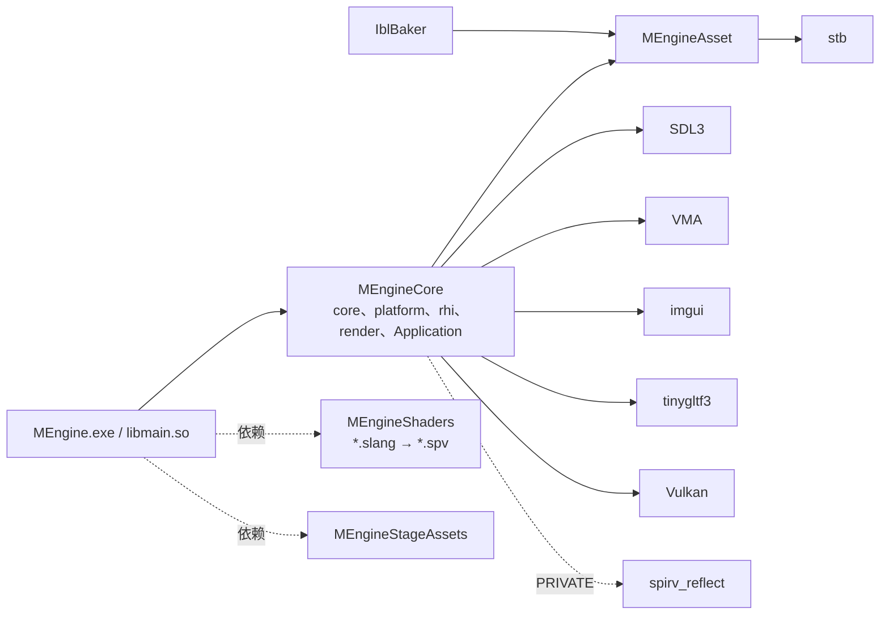
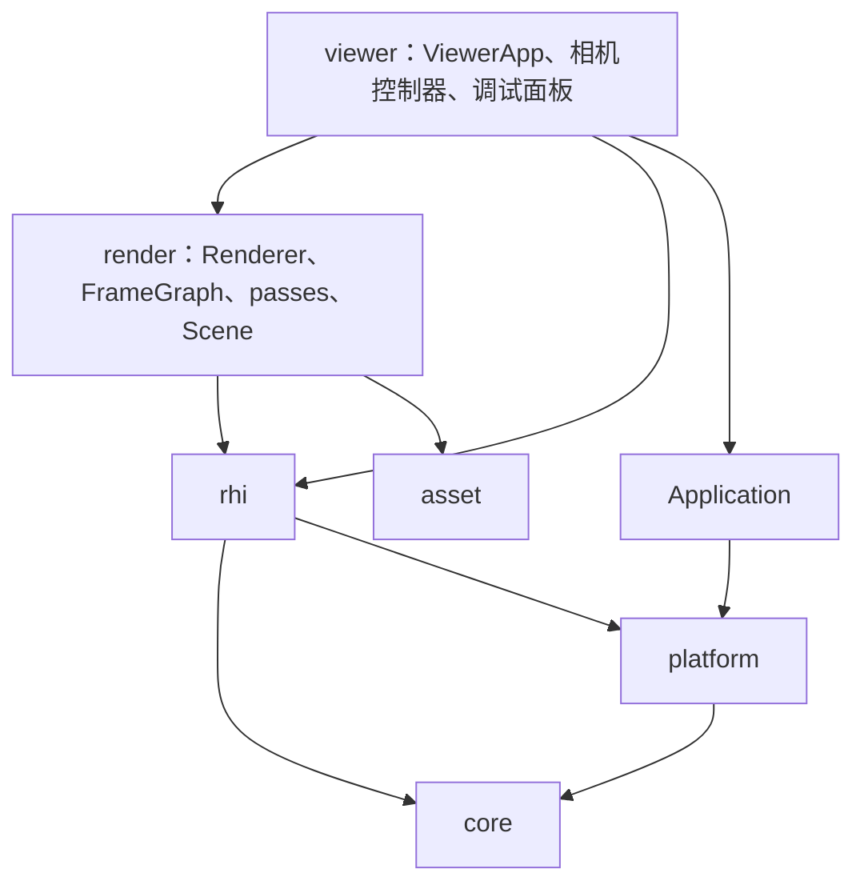
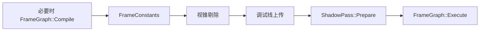
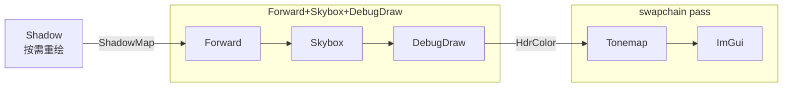
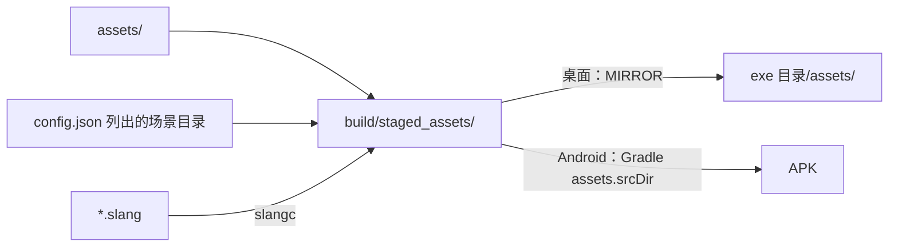

# MEngine 框架设计

本文描述 MEngine 的分层、模块职责、关键机制和扩展方式。接口细节以头文件为准；着色模型见 [`UE4-RealShading-2013.md`](UE4-RealShading-2013.md)，集成路线与各阶段的设计决定见 [`Roadmap.md`](Roadmap.md)。

## 0. 定位与约束

MEngine 是同时运行在 Windows 桌面和 Android 上的 glTF 2.0 PBR 查看器。RHI 以 *Mastering Graphics Programming with Vulkan* 的 Raptor 引擎为蓝本，着色按 UE4 2013 讲义。

| 约束 | 原因 | 对设计的影响 |
| --- | --- | --- |
| Vulkan 1.1，无 dynamic rendering | 目标手机不支持 1.2+ 和 `VK_KHR_dynamic_rendering` | 一律走 `VkRenderPass` + `VkFramebuffer`，render pass 按输出格式缓存 |
| 只链接 Vulkan 1.0 符号 | Android API 24 的 `libvulkan.so` 只导出 1.0 入口 | 1.1 与扩展函数运行时获取；VMA 用动态函数；启用特性仍走 1.0 的 `pEnabledFeatures` |
| SPIR-V 1.3 | Vulkan 1.1 能接受的最高版本 | `slangc -profile spirv_1_3` 离线编译 |
| 单一图形队列 | 手机通常只有一个队列族 | 上传、渲染、compute 都在同一队列 |
| 移动端 tile GPU | 带宽敏感 | 前向渲染；不需要的附件用 `DONT_CARE` |

## 1. 目录与构建目标

```
cmake/                 资产暂存与镜像、Slang 编译、布局校验、第三方库
source/engine/core     日志、断言、文件系统、JSON、计时、Handle、ResourcePool
source/engine/platform SDL 窗口与输入
source/engine/asset    纯 CPU 解码：PNG/JPEG/HDR、KTX2、BC7（与 IblBaker 共用，不依赖 Vulkan）
source/engine/rhi      GpuDevice、CommandBuffer、资源描述与池、Swapchain、Profiler、反射、pipeline cache、设备能力
source/engine/render   Renderer、Scene、GltfLoader、Environment、Camera、Culling、DebugDraw、ImGuiLayer、graph/、passes/
source/viewer          查看器：入口、ViewerApp、配置、相机控制器、Frame Graph 与设备能力面板
source/shaders         Slang 着色器，common/ 为共享头
programs/IblBaker      离线 IBL 烘焙（仅桌面）
assets/                config.json、环境贴图
android/               Gradle 工程（SDL android-project 模板）
```



Debug 和 RelWithDebInfo 定义 `MENGINE_ENABLE_VALIDATION_LAYERS`：开启校验层，接口与声明错误抛异常（其他构建记 ERROR 后继续）。

## 2. 分层



- 自上而下单向依赖。`rhi` 不认识 `render` 的类型；`render` 只通过 `GpuDevice` 和 `CommandBuffer` 使用 Vulkan（例外：`ImGuiLayer` 把设备句柄交给 imgui 官方后端）。
- `ViewerApp` 持有 `GpuDevice`、`ImGuiLayer`、`Renderer`，负责它们的初始化与销毁顺序。
- 命名空间：`mengine`、`mengine::asset`、`mengine::rhi`、`mengine::render`。

## 3. 应用层

- **入口**：SDL3 main callbacks，桌面和 Android 共用 `viewer/main.cpp`。`Application` 把回调转成 `OnInitialize / OnFrame / OnEvent / OnSuspendChanged / OnShutdown`；挂起或最小化时不调用 `OnFrame`；回调抛出的异常在基类记录，初始化或帧内的异常让程序以失败退出。
- **ViewerApp**：读 `config.json`、加载环境与首个场景；场景切换在下一帧 `BeginFrame` 之前执行（需要等 GPU 空闲）；换场景后复位相机与灯光；把窗口尺寸变化和前后台切换转给 `GpuDevice`。
- **输入**：`Input` 的坐标统一为窗口点（与 ImGui 相同）；按下点落在 UI 上的按压不当作相机输入。桌面关闭“触摸转鼠标”，Android 保留它供 ImGui 使用，`Input` 忽略这类合成鼠标事件。
- **相机控制器**：`CameraController` 把输入变成 `render::Camera` 的运动，渲染器不知道当前模式。切换模式时新控制器接管当前位姿。
  - `FlyCameraController`：桌面右键转视角 + WASD/QE；触摸左半屏虚拟摇杆、右半屏转视角。
  - `OrbitCameraController`：移植 Vulkan-glTF-PBR 的 look-at 相机，内部保存原版的 `rotation / position`，每帧换算为等价的 MEngine 相机，因此操作手感与原版一致，切换模式时画面不跳。

## 4. RHI 层

### 4.1 资源模型

- **Creation 描述**：每种资源一个纯数据的 `XxxCreation`，带链式 `AddXxx`。
- **句柄 + 池**：`GpuDevice::CreateXxx` 返回 `Handle<Tag>`（index + generation，不同资源的句柄类型不能混用）；对象存在固定容量、永不扩容的 `ResourcePool` 里，所以 `AccessXxx` 取得的指针在资源存活期间稳定，失效句柄返回 `nullptr`。
- **延迟销毁**：`DestroyXxx` 立即使句柄失效，Vulkan 对象在可能使用它的帧完成后销毁；`WaitIdleAndReleaseDeferred` 在帧外一次性释放（切换场景时用，避免新旧场景同时占显存）。
- **薄命令封装**：`CommandBuffer` 把句柄解析为 Vulkan 对象再录制，附带用途、对齐、pass 内外等检查，失败时记错误并跳过该命令。

与 Raptor 的差异：句柄带 generation；`ShaderState` 并入 `PipelineCreation`；没有 `Renderer` 资源缓存层。

### 4.2 Render pass 模型

- `RenderPassOutput` 只描述附件格式、load 操作和最终用途，可哈希。`GetVulkanRenderPass` 按它缓存 `VkRenderPass`，管线也按它创建；render pass 兼容性只看格式，所以 load/store 变化不需要重建管线。
- `RenderPass`（池资源）持有具体的输出纹理、framebuffer 和尺寸。swapchain pass 的 framebuffer 由 `Swapchain` 按图像索引提供。
- 最终布局：可呈现颜色 → `PRESENT_SRC`；离屏颜色和需要采样的深度 → `SHADER_READ_ONLY`；其他深度 → `DEPTH_STENCIL_ATTACHMENT`，只在需要时 store。
- 每个 render pass 带进出两条外部 subpass dependency，覆盖附件之间和附件与片元着色器读之间的同步；更远的依赖（compute、transfer）由 `BindPass` 自动补 barrier。

### 4.3 同步模型

- `ResourceState`（`GpuEnums.hpp`，来自 Raptor / D3D12）是位标志，只读状态可组合；`VulkanUtils` 把它翻译为布局、访问掩码和管线阶段。阶段直接由状态推导，所以片元读和 compute 读能区分。
- 每个 `Texture` 记录录制到当前为止的状态。前提是每帧只有一个按顺序录制的命令缓冲，录制顺序即执行顺序。Buffer 不跟踪状态，barrier 由调用方给出新旧两端。
- `ExecutionBarrier` 把若干纹理、buffer 和全局 barrier 合成一次 `vkCmdPipelineBarrier`：新状态是旧只读状态的子集时丢弃；只读到只读但多了读者时仍录制并合并状态；只覆盖部分子资源的 barrier 必须显式给出旧状态。render pass 内调用 barrier 会报错。
- `BindPass` 在附件上次访问超出 subpass dependency 覆盖范围或布局不对时先插 barrier；`EndPass` 按最终布局更新附件状态。因此纯图形路径不需要手写 barrier。

### 4.4 上传

- 初始数据（buffer、纹理、mip 生成、布局转换）录进上传命令缓冲，提交后**不等待**：只有一个队列，批次排在之后所有帧的前面，批次末尾的 barrier 覆盖后续帧对这些资源的读取。销毁照常走按帧号的延迟销毁：`vkQueueSubmit` 的 fence 也覆盖提交顺序更早的批次。
- 批次轮流使用 3 个上传槽，每个槽有自己的命令池、fence 和 24 MB staging 段（常驻映射的 72 MB 环）；超过一段的上传用专用 staging buffer。槽要等它的 fence 才能复用，这是上传唯一的等待；`BeginFrame` 顺手回收已完成的槽。
- `BeginUploadBatch / EndUploadBatch` 可嵌套，最外层结束时提交；段放不下时提交并在下一个槽继续。`UploadBatchHasRoomFor` 让调用方把一次提交控制在一个槽内：上一个批次可能还排在一个等待交换链图像的帧后面，跨槽可能要等呈现。`SceneLoader` 每帧一个批次，场景加载期间不在 CPU 上等 GPU。

### 4.5 帧

- `kMaxFramesInFlight = 2`。每个帧槽有自己的命令池、主命令缓冲、`imageAvailable` 信号量和 fence；`renderFinished` 按 swapchain 图像分配。
- `BeginFrame` 等本槽 fence、执行到期的延迟销毁、acquire 图像、开始命令缓冲；返回 false 时（最小化、swapchain 过期、surface 丢失）调用方跳过这一帧。fence 只在 acquire 成功后才重置。
- 每帧常量从动态 uniform 环分配（每帧槽 1 MiB，按 `minUniformBufferOffsetAlignment` 对齐），以动态偏移绑定。
- `GpuProfiler` 的 timestamp 查询按帧槽切分，fence 等过之后读回，不阻塞 CPU；结果以纳秒记录，并带上所属帧号。

### 4.6 Swapchain

- VSync 用 FIFO；关闭时依次尝试 IMMEDIATE、MAILBOX。
- `SurfaceLost`（Android 退到后台）销毁 swapchain 和 surface，回前台后重建；Android 用 identity pre-transform，`SUBOPTIMAL` 不触发重建（否则会无限重建）。
- 窗口尺寸为 0 时不创建 swapchain。

### 4.7 Pipeline cache 与着色器接口校验

- 一个共享的 `VkPipelineCache`（ImGui 后端也用它），持久化到 `SDL_GetPrefPath` 下的 `pipeline_cache.bin`。文件带自定义头（魔数、设备标识、长度、FNV-1a 校验和），读取时还校验驱动头和 `pipelineCacheUUID`；任何不符都丢弃数据，因为部分移动端驱动遇到损坏数据会崩溃而不是报错。写回时机：退出、场景加载预热后、Android 退到后台；先写临时文件再改名。
- `CreatePipeline` 用 SPIRV-Reflect 反射每个阶段，校验绑定、类型、数量、阶段标志、push constant 和特化常量与手写 layout 一致。共享的 set 0 / set 1 手写；pass 私有 layout 可由反射生成（`ReflectShaderState` + `BuildDescriptorSetLayout`）。
- 线程约束：`VkPipelineCache` 需要外部同步，目前所有管线都在主线程创建。

### 4.8 设备能力

`DeviceCapabilities` 在 `Init` 时用运行时获取的 `vkGetPhysicalDeviceFeatures2/Properties2` 查询核心 1.0/1.1 与 T1/T2 扩展的特性和限制、队列族、内存堆与格式支持，并按 Roadmap 第 1 节判定 T0/T1/T2 档位。只查询，不启用新能力；查看器的 Device Capabilities 窗口显示全部结果。

## 5. 渲染层

### 5.1 一帧

`Renderer::Render` 只准备每帧数据，pass 顺序、render pass、barrier 和 resize 都交给 Frame Graph：





- **阴影**：方向光的正交投影贴合场景包围盒，Y 翻转与相机一致，所以沿用前向的绕序规则。阴影图由 `ShadowPass` 持有并导入图，只在光源方向、场景或开关变化时重绘。Shadow 节点被禁用时 `Renderer` 关闭阴影采样，避免显示不再跟随光源的旧阴影。
- **视锥剔除**（`Culling.hpp`）：每个 draw 在加载时存世界空间 AABB；每帧从相机 view-projection 提取 6 个平面做保守测试，得到按原顺序排列的可见下标，经 `RenderView::visibleDraws` 交给 Forward。阴影投射者不剔除：光源视锥覆盖整个场景，按相机剔除会让缓存的阴影图随相机移动重绘。剔除可关闭、可冻结视锥，并能画出每个 draw 的包围盒。
- **Forward render pass**：先不透明后 MASK，然后天空盒（只填远平面像素），最后调试线。调试线放在天空盒之后，因为线不写深度，先画会被天空覆盖。
- **Tonemap**：曝光 + Uncharted 2 曲线；表面不是 sRGB 格式时在着色器里编码。调试线的片元着色器反解这条曲线，使显示颜色等于给定颜色。

### 5.2 描述符与常量

| 位置 | 内容 | 更新频率 |
| --- | --- | --- |
| set 0 binding 0 | `FrameConstants`（dynamic uniform） | 每帧 |
| set 0 binding 1–4 | 辐照度立方体、预过滤镜面立方体、BRDF LUT、阴影图（比较采样） | 换环境时 |
| set 1 | `MaterialData` + 5 张材质纹理 | 每材质一份 |
| push constant | `DrawConstants`：model 与 normal 矩阵（128 字节） | 每次绘制 |
| 特化常量 0 | alpha MASK 变体 | 每个管线变体 |

`RenderTypes.hpp` 与 `shaders/common/Bindings.slang` 的结构同名同成员。构建时 `slangc -reflection-json` 生成 `static_assert`，任何一边改了布局而另一边没跟上都会编译失败。

### 5.3 Pass

| Pass | 图中的访问 | 管线变体 |
| --- | --- | --- |
| `ShadowPass` | 导入 D16 2048² 阴影图 | {MASK, 双面, 镜像}，场景加载后预热 |
| `ForwardPbrPass` | 创建 `HdrColor`（RGBA16F）和 `SceneDepth`；读 `ShadowMap` | {MASK, 双面, 镜像, 切线}，场景加载后预热 |
| `SkyboxPass` / `DebugDrawPass` | Load `HdrColor`、`SceneDepth` | 1 个；DebugDraw 没有线时不活跃 |
| `TonemapPass` | 读 `HdrColor`，写 backbuffer | 1 个；私有 set 由反射生成 |
| `ImGuiPass` | Load backbuffer | imgui 后端自带 |

管线在 `OnCompiled` 中按图给出的 `RenderPassOutput` 创建，只在格式不兼容时重建。`kPipelineKeyMirrored` 表示节点变换行列式为负（glTF 要求翻转绕序）；没有切线的 primitive 在着色器里用导数构建切线空间。

### 5.4 场景与加载

- `Scene` 只含 GPU 句柄与绘制数据：场景拥有的 buffer / 纹理 / 采样器；每个 primitive 4 个分离的顶点流、索引（存 `Scene::buffers` 的下标，CPU 阶段与 GPU 阶段共用同一个 primitive 结构）和局部包围盒；材质 uniform 与 descriptor set；draw 列表（primitive、材质、管线 key、`DrawConstants`、世界 AABB）。节点层级在加载时展开，渲染时不遍历场景图。
- glTF 加载分两阶段（`GltfLoader.hpp`）：
  - CPU 阶段，任意线程、不接触 GPU：`ParseGltfScene` 做 tinygltf 解析（文件回调走资产文件系统，Android 可读 APK）、收集纹理请求、材质 → primitive（accessor 转换、平面法线）→ 展开节点并按（不透明在前、管线 key、材质）稳定排序，产出 `GltfSceneData`（`GltfSceneData.hpp`，持有解析后的模型）；`PrepareGltfTexture` 读取并解码单个纹理请求，可对不同请求并发调用。
  - GPU 阶段，只在主线程：`GltfSceneUploader` 按字节预算逐步 `UploadBuffers`、逐个 `UploadTexture`，最后 `Finish` 创建采样器、材质与 descriptor set 并填好 `Scene`。
  - `SceneLoader`（`Renderer::RequestScene` / `UpdateSceneLoad`）把两个阶段跨帧组合：解析和解码是 enkiTS 任务，解码最多领先上传 `max(2, 工作线程数)` 个纹理（限制驻留的解码像素）；主线程每帧调用一次，在一个上传批次里传完已就绪的 buffer 和纹理（每次约 32 MB 预算），全部完成后 `Finish`、预热管线。加载期间场景没有 draw，画面继续刷新；查看器在底部显示进度条，完成时复位相机和灯光。取消（切换场景）不等待：在途任务连同它读取的数据转为孤儿，跑完后由下一次 `Update` 释放，`Shutdown` 才等待。加载任务是低优先级。
  - 色彩空间由用途决定：base color、emissive、specular-glossiness 为 sRGB，其余线性。
  - `MSFT_texture_dds` 优先：设备支持 BC 就原样上传，否则 CPU 解码 BC7，从不大于 512² 的 mip 开始。
  - 一个 glTF buffer view 对应一个 GPU buffer；能直接引用的 accessor 直接引用，其他（交错、归一化整数、sparse、8 位索引）先在 CPU 上转换。
  - alpha BLEND 退化为 MASK；`KHR_materials_transmission` 的 primitive 不生成 draw。
  - 纹理或 primitive 出错只记警告并降级；文件级错误让加载失败，场景保持为空。
- `Environment`：读取 IblBaker 烘焙的 `specular.ktx2`（每级 mip 对应一个粗糙度）、`irradiance.ktx2`、`brdf_lut.ktx2`；缺失或非法时退回均匀环境。

### 5.5 Frame Graph

`render/graph/FrameGraph.*` 参照 Raptor 第 4、5 章，建立在 `RenderPassOutput` 缓存、`Texture::state`、`ExecutionBarrier` 和延迟销毁之上。设计决定见 Roadmap G1–G13。

- **节点**：`FrameGraphPass` 子类，图不拥有它，注册顺序即执行顺序。`Setup` 只声明（每次编译都调用，禁用的节点也一样）；`Execute` 录制；`IsActive` 每帧判断，不活跃的节点连同 barrier 跳过，写过的导入纹理保留旧内容；`OnCompiled` 在纹理或 render pass 重建后回调。
- **资源**：按名字引用。`CreateTexture` 为瞬时纹理（尺寸可跟随 swapchain）；`ImportTexture / ImportBuffer` 为跨帧保留的外部资源；`ImportBackbuffer` 映射到 swapchain pass。纹理用途由访问推导（附件 → render target，`UnorderedAccess` → storage 并检查格式）。
- **编译**：在启动、resize、开关变化后进行。
  - 依赖只指向更早的写入者，结构上无环；本帧首个写入者之前读瞬时纹理是声明错误。
  - 从写 backbuffer 的节点和 side effect 节点反向剔除。
  - 本帧没有写入者时 `Load` 改为 `Clear`；深度只在后面有访问者或它是导入纹理时 store，被着色器读取时加 `sampleDepth`。
  - 相邻图形节点附件集合相同、后加入者全部 `Load`、组内其他访问只有读-读、中间没有 compute 节点时，合并为一个 render pass，组名用 `+` 连接。
  - 描述相同、生命周期不重叠的瞬时纹理共用一个句柄（可关闭）。
  - 声明错误按构建类型抛异常或跳过出错节点；用户禁用的节点不算错误，依赖它的节点显示为 skipped。
- **执行**：只遍历编译好的调度表，每帧不分配内存。非附件访问合成 `ExecutionBarrier`（每批最多 8 项）；导入 buffer 的状态由图跨帧跟踪；每个节点和合并组自动包一层同名的 CPU（录制耗时，`core/CpuProfiler`）与 GPU 计时，外加根作用域 `Frame Graph`。查看器的 Profiler 窗口按帧号把两者配对（GPU 结果晚 `kMaxFramesInFlight` 帧到达），显示单帧值与滑动平均，精确到纳秒。
- **调试**：`GetDebugInfo()` 返回编译快照，供查看器的 Frame Graph 面板与节点图使用。

## 6. 资源与着色器管线



- 场景列表在 CMake **配置阶段**读取，修改后需要重新配置；暂存和镜像会删除源中已不存在的文件。
- 运行时资产路径相对暂存根目录（桌面 `<exe>/assets/`，Android 为 APK assets），读取都经 `SDL_LoadFile`。
- 着色器每个入口点编译为 `shaders/<文件>.<入口>.spv`，在 `CMakeLists.txt` 用 `MEngineCompileShader` 注册；新增需要镜像的常量结构时，加进 `MEngineGenerateShaderLayoutChecks` 的 `STRUCTS`。
- IblBaker 逐行移植讲义的 HLSL（`UeBrdf.hpp`），输入 `.hdr` 或 KTX1 立方体，输出 5.4 的三个 KTX2，只链接 `MEngineAsset`。

## 7. 平台差异

| 方面 | 桌面（Windows） | Android |
| --- | --- | --- |
| 应用目标 | `MEngine.exe` | `libmain.so`，arm64-v8a，minSdk 24，`c++_static`，16 KB 页对齐 |
| 资产 | `<exe>/assets/` | APK assets |
| 用户数据 | `%APPDATA%/MEngine/MEngine/` | 应用内部存储，退到后台时写回 pipeline cache |
| 输入 | 鼠标 + 键盘，可选触摸 | 触摸（虚拟摇杆），返回键退出 |
| 前后台 | 最小化时跳过帧 | 退到后台销毁 surface，回前台重建 |
| BC 纹理 | 通常直接采样 | 通常 CPU 解码 BC7（≤ 512²） |

## 8. 线程模型

- **主线程独占设备**：`GpuDevice` 的创建、销毁、上传、提交只能在调用 `Init` 的线程上进行（每个入口都有断言）。
- **任务调度**：`Application` 持有 enkiTS 调度器（硬件线程数个线程，主线程等待任务时也会执行任务），`GetTaskScheduler()` 交给需要的模块。任务只做 CPU 工作：读文件、解析、解码；之后的并行录制任务只录 secondary 命令缓冲，期间主线程等待，设备只读。
- **文件读取**：Android 上 SDL 的 asset manager 在首次读文件时惰性创建且不加锁，所以第一次读取必须在主线程（读 `config.json` 满足这一点）。
- **上传**：每个上传批次都在 CPU 上等自己的 fence。fence 的信号要等队列中此前提交的工作全部完成，所以加载期间每帧的上传最多多等一帧。staging 用一个常驻的 64 MB 环（Windows 上逐个分配和释放 staging 内存会让队列停顿数百毫秒），更大的上传单独分配。

## 9. 错误处理

- 日志 `MENGINE_LOG_INFO / WARN / ERROR`（SDL 日志：桌面 stdout，Android logcat），断言 `MENGINE_ASSERT`。
- Vulkan 错误：`CheckVk` 转成 `std::runtime_error`。
- 资源数据错误：记警告并降级（dummy 纹理、跳过 primitive、均匀环境、空场景）。
- API 误用：`CommandBuffer` 记错误并跳过命令；着色器接口与 Frame Graph 声明错误在校验构建中抛异常。

## 10. 扩展方式

**新增图形 pass**：

1. 写 Slang 文件，在 `CMakeLists.txt` 注册入口。
2. 在 `render/passes/` 继承 `FrameGraphPass`：`Init` 加载 SPIR-V、建 layout；`Setup` 声明附件和读取（资源名放 `RenderView.hpp`）；`OnCompiled` 按 `GetRenderPassOutput()` 建管线、更新描述符；`Execute` 录制。按帧决定是否执行的 pass 覆写 `IsActive`，多变体的 pass 提供 `WarmPipelines`。
3. 在 `Renderer::Init` 中按执行顺序 `AddPass`。resize 和 render pass 合并由图处理。
4. 新的每帧数据同时改 `RenderTypes.hpp` 和 `Bindings.slang`，布局校验会发现不一致。

**新增 compute pass**：入口标注 `[shader("compute")]`，storage image 声明 `[[vk::image_format(...)]]`；layout 阶段写 `COMPUTE_BIT`；以 `FrameGraphNodeType::Compute` 注册并用 `Read / Write / ReadWrite` 声明访问，barrier 由图生成。

## 11. 当前限制

- 无抗锯齿；只有 CPU 视锥剔除（无遮挡剔除、无 GPU 剔除）；alpha BLEND 当作 MASK；无透射。
- 只有方向光有阴影。
- 所有工作在单一图形队列上，单命令缓冲录制；上传在主线程按帧分批，每批同步等待。
- 描述符没有数组和 bindless；每个 `DescriptorSetCreation` 最多 16 个资源，每个管线最多 4 个 set layout、3 个着色器阶段、4 个颜色附件。
- Frame Graph 没有跨帧历史资源和图内瞬时 buffer；纹理复用只在描述相同的纹理之间。
- 只查询、尚未启用 Vulkan 1.1 以上的可选能力。
- 代码审查发现的设计问题与待办见 [`Review.md`](Review.md)。
