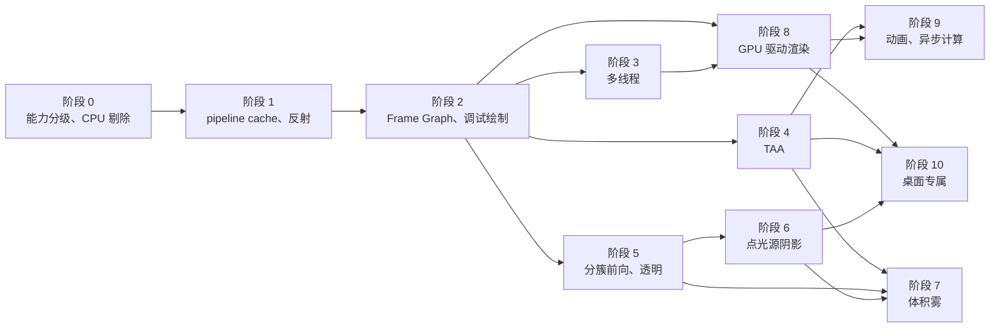

# MEngine 集成 Raptor 路线图

本文梳理 *Mastering Graphics Programming with Vulkan* 的 Raptor 引擎每一章新增的特性，评估它们在 MEngine 硬约束（见 [`Architecture.md`](Architecture.md) 第 0 节）下的可行性，并给出集成顺序。架构细节以 `Architecture.md` 为准，本文只描述“要做什么、按什么顺序做”。

## 0. 资料与阅读方式

- 参考代码：`d:/Final/Mastering-Graphics-Programming-with-Vulkan/source/chapterN/`。每章是一份完整快照，公共库在 `source/raptor/`（`foundation/`、`application/`）。“新增内容”由相邻两章的 diff、`graph*.json` 中启用的 pass 和书的章节主题共同确定。
- **代码目录比书的章节超前**，移植时以“该特性在 `graph*.json` 中被启用的那一章”为准：

  | 特性 | 书中章节 | 代码最早出现 | 首次启用 |
  | --- | --- | --- | --- |
  | 加速结构、光追管线、`RayTracingTestPass` | 第 12 章 | `chapter10` | `chapter10/graph_ray_tracing.json` |
  | 光追阴影 `ShadowVisibilityPass` | 第 13 章 | `chapter11` | `chapter11/graph_ray_tracing.json`（`chapter12` 中又被移除，`chapter13` 恢复） |
  | DDGI `IndirectPass` | 第 14 章 | `chapter13` | `chapter13/graph.json`（`indirect_lighting_pass`） |
  | 反射 + SVGF | 第 15 章 | `chapter13`（pass 类已存在） | `chapter15/graph_ray_tracing.json` |

- Raptor 的目标是 Vulkan 1.2 桌面（`--target-env vulkan1.2`），第 2 章起所有着色器都假设 bindless（`global_textures[]`）。移植每个着色器都要改写成 MEngine 的 Slang + 显式 set/binding 约定，这是每个阶段的主要工作量。

## 1. 设备能力分级

MEngine 的基线是 Vulkan 1.1 手机。Raptor 的特性按设备能力分三档，每个特性都标注所需档位；T0 必须有可用路径，除非明确标为“仅桌面”。

| 档位 | 典型设备 | 能力 |
| --- | --- | --- |
| **T0 基线** | 目标手机 | Vulkan 1.1 核心；单一图形队列；无 descriptor indexing、无 `drawIndirectCount`；`multiDrawIndirect`、`imageCubeArray`、`pipelineStatisticsQuery` 不保证 |
| **T1 扩展** | 较新的手机、所有桌面 | `VK_EXT_descriptor_indexing`、`VK_KHR_draw_indirect_count`、`VK_KHR_timeline_semaphore`、`VK_EXT_sampler_filter_minmax`、`VK_KHR_create_renderpass2`、`imageCubeArray`、`multiDrawIndirect` |
| **T2 桌面** | 桌面独显 | 独立 compute 队列、mesh shader（`VK_NV_mesh_shader` / `VK_EXT_mesh_shader`）、`VK_KHR_fragment_shading_rate`、sparse residency、`VK_KHR_acceleration_structure` + `VK_KHR_ray_tracing_pipeline` + `VK_KHR_ray_query` + `VK_KHR_buffer_device_address` |

实现规则：

- 只链接 1.0 符号的约束不变：`vkGetPhysicalDeviceFeatures2`、`vkGetPhysicalDeviceProperties2`（1.1 入口）和所有扩展函数都经 `vkGetInstanceProcAddr` / `vkGetDeviceProcAddr` 运行时获取。
- `GpuDevice` 汇总成一个能力结构（例如 `DeviceCapabilities`），渲染层只查询能力，不直接判断扩展名。ImGui 面板显示当前档位与各开关。
- 不引入 dynamic rendering：Raptor 第 4 章起在有扩展时使用 `VK_KHR_dynamic_rendering`，MEngine 一律走 `VkRenderPass`。

## 2. 各章新增内容

每章分四部分：Raptor 新增了什么（括号内为代码位置）、所需 Vulkan 能力、MEngine 现状、集成方式与取舍。

### 第 1 章 Raptor 与 Hydra 入门

- **新增**：基础库（分配器、容器、文件、日志、服务，`raptor/foundation`）；窗口、输入、相机（`raptor/application`）；RHI：`GpuDevice`、`CommandBuffer`、`GpuResources`（Creation 描述 + 句柄 + 资源池、延迟销毁）；`GpuProfiler`（timestamp query）；ImGui 服务；带资源缓存的 `Renderer`；`main.cpp` 中的 glTF 加载与绘制。
- **能力**：T0。
- **MEngine 现状**：已完成（阶段 0）。RHI 按此章蓝本实现，并提前吸收了后续章节的 `ResourceState`、`ExecutionBarrier`、compute、indirect draw（`02d7c32`）。
- **取舍**：不采用 foundation 库（用 STL / SDL）、`Renderer` 资源缓存层、独立的 `ShaderState` 资源（见 `Architecture.md` 4.1）。

### 第 2 章 改进资源管理

- **新增**：
  - Bindless 纹理：descriptor indexing，全局纹理数组（binding 10，最多 1024），`UPDATE_AFTER_BIND` + `PARTIALLY_BOUND`（`gpu_device.cpp` 中 `[TAG: BINDLESS]`）。
  - Pipeline cache：`create_pipeline(creation, cache_path)` 读写 `VkPipelineCache` 文件。
  - 着色器反射：运行时调用 `glslangValidator` 编译 GLSL，`spirv_parser.cpp` 解析 SPIR-V，自动生成 descriptor set layout。
- **能力**：pipeline cache、反射为 T0；bindless 为 T1。
- **MEngine 现状**：已完成 pipeline cache 与反射（阶段 1）；bindless 未做，每材质一个 set。
- **集成**（已实现，细节见 `Architecture.md` 4.12、5.2）：
  - Pipeline cache（T0）：存到 `SDL_GetPrefPath`，带自定义头和校验和，并检查驱动头的 vendorID / deviceID / pipelineCacheUUID；在退出、场景加载预热之后、Android 退到后台时写回；场景加载后按需预热变体。
  - 反射（T0）：着色器保持 Slang 离线编译。运行时用 Khronos SPIRV-Reflect 解析 `.spv`（取代移植 `spirv_parser`），读取绑定、push constant、特化常量 id（对应第 9 章新增的 `SpecId` 解析）；`CreatePipeline` 据此校验手写 layout，pass 私有 layout 由反射生成。另外在构建时用 `slangc -reflection-json` 生成 `static_assert`，校验 C++ 与 Slang 常量结构的布局。
  - Bindless（T1）：推迟到阶段 8（GPU 驱动渲染）再引入，因为只有合批的 indirect 绘制才真正需要它；T0 保留每材质 set。
- **阶段 1 的设计决定**：

  | 编号 | 决定 |
  | --- | --- |
  | D1 | 运行时反射用 SPIRV-Reflect（子模块 `third_party/SPIRV-Reflect`，tag `vulkan-sdk-1.4.363.0`），不手写解析器 |
  | D2 | 共享 set 0 / set 1 手写，创建管线时校验；pass 私有 layout 由反射生成，可用 `FindBinding` 覆盖 |
  | D3 | 校验失败：定义 `MENGINE_ENABLE_VALIDATION_LAYERS` 时抛异常，否则记 ERROR 继续 |
  | D4 | 特化常量继续所有阶段共用一份 `VkSpecializationInfo`；id 不在任何阶段中时记 WARN |
  | D5 | cache 文件 = 32 字节自定义头（`MEPC`、版本、vendor/device/driver、长度、FNV-1a 64）+ 驱动数据；读取时同时校验驱动头；上限 64 MB |
  | D6 | 路径由 `GpuDeviceCreation::pipelineCachePath` 传入，空表示不持久化 |
  | D7 | 写回：`Shutdown`、场景加载预热后、Android 挂起时；长度不变则跳过；先写临时文件再改名 |
  | D8 | 只预热当前场景 draw 用到的 key，由各 pass 的 `WarmPipelines` 负责 |
  | D9 | 构建期 `slangc -reflection-json` → `static_assert`，C++ 与 Slang 结构同名同成员 |

### 第 3 章 多线程

- **新增**：
  - enkiTS 任务调度器。
  - `AsynchronousLoader`：固定在 I/O 线程上的任务，使用独立 transfer 队列、64 MB 常驻映射 staging buffer 和信号量把上传与渲染并行。
  - 并行录制：每线程每帧槽一个命令池，`get_secondary_command_buffer` + `begin_secondary(render_pass)`，多个 `ITaskSet` 分段录制 draw。
  - 管线描述 JSON（`shaders/main.json`：顶点输入、渲染状态）。
- **能力**：secondary command buffer 为 T0；独立 transfer 队列不在 T0 范围内（单一队列约束）。
- **MEngine 现状**：纹理解码已在工作线程并行；场景加载同步阻塞帧；单命令缓冲录制。
- **集成**：
  - 线程池：enkiTS 或自写 `std::jthread` 池，供解码、加载、录制共用。
  - 异步加载（T0）：文件读取、glTF 解析、纹理解码全在工作线程；GPU 上传仍在图形队列，每帧按 staging 预算提交一部分，靠帧 fence 判断完成，完成后原子替换 `Scene`。切换场景时不再卡住画面。
  - 并行录制（T0）：forward 与 shadow 的 draw 分段，用 secondary command buffer 录制，主命令缓冲 `vkCmdExecuteCommands`。注意同一 subpass 不能混用 inline 与 secondary 内容，skybox、ImGui 需要一起改成 secondary 或拆到独立 subpass / pass。
  - 管线描述 JSON：不采用，MEngine 用 C++ `PipelineCreation` + 反射。

### 第 4 章 Frame Graph

- **新增**：
  - `frame_graph.cpp`：解析 `graph.json`，按输入输出建边（`compute_edges`），拓扑排序，按引用计数复用纹理（free list，资源别名），自动创建 render pass 和 framebuffer。
  - 场景层重构：`gltf_scene`、`obj_scene`（assimp）、`scene_graph`、`render_scene`、`render_resources_loader`（加载 graph 和 technique JSON）。
  - 新 pass：depth pre-pass、G-buffer、延迟 PBR 光照（`pbr_lighting`）、透明、景深（`dof.glsl`）、全屏三角形。
- **能力**：T0。
- **MEngine 现状**：已完成（阶段 2）。Shadow、Forward、Skybox、DebugDraw、Tonemap、ImGui 都是图节点，`Renderer::Render` 不再手写 pass 顺序、resize 和阴影重绘判断。
- **集成**（已实现，细节见 `Architecture.md` 5.1、5.8）：
  - Frame Graph（T0）：C++ `FrameGraphPass` 子类声明资源（不用 JSON，开关在查看器面板里），构建在现有 `RenderPassOutput` 缓存、`Texture::state` 跟踪和 `ExecutionBarrier` 之上。图负责剔除、`enabled` 开关、compute 节点（第 5 章的 `type: compute`）、纹理和 buffer barrier、load/store 推导、render pass 合并，swapchain 尺寸变化时自动重新编译。
  - 跨帧资源（history）：**推迟到阶段 4**，与 TAA 一起做，到时有真实的使用者来验证设计。
  - 资源别名：只在描述完全相同、生命周期不重叠的纹理之间复用，可以关闭；内存级别名（VMA aliasing image）作为后续优化。图内瞬时 buffer（由图创建的 storage / indirect buffer）推迟到阶段 8，GPU 驱动渲染才是它的第一个使用者；在此之前 buffer 只能导入。
  - 迁移：现有的 5 个 pass 全部迁进图中，画面与迁移前一致；DamagedHelmet 1280×720 下，Forward（含 Skybox）约 2.3 ms，Tonemap + ImGui 约 0.4 ms，与迁移前相同；一帧最多 3 个 render pass。
  - 延迟渲染：**不采用**。移动端 tile GPU 对带宽敏感，MEngine 坚持前向渲染。深度 pre-pass 推迟到 TAA 或 Hi-Z 真正需要可采样深度时，再作为节点加入：届时由读者声明 `Read(ShaderResource)`，图会自动推导出 `sampleDepth`。景深作为可选后处理，优先级低。
- **阶段 2 的设计决定**：

  | 编号 | 决定 |
  | --- | --- |
  | G1 | 节点用 C++ 虚接口 `Setup / Execute / IsActive / OnCompiled` 声明，图不拥有 pass；不解析 JSON |
  | G2 | 注册顺序就是执行顺序，依赖只能指向更早的写入者，结构上不会有环；在本帧首个写入者之前读取瞬时纹理属于声明错误 |
  | G3 | 访问用 `ResourceState` 声明；纹理用途由访问推导（附件 → RenderTarget，`UnorderedAccess` → Storage 并检查格式） |
  | G4 | 非附件访问由图合批成 `ExecutionBarrier`（每批最多 8 项），附件之间的同步交给 subpass dependency 和 `BindPass`；导入 buffer 的状态由图跨帧跟踪 |
  | G5 | 本帧还没有写入者时，`Load` 自动改为 `Clear`；深度只在后面有读者或它是导入纹理时 store，被着色器读取时加 `sampleDepth`，因此场景深度不写回 |
  | G6 | 两种开关：`enabled` 改变图的结构，需要重新编译；`IsActive()` 每帧判断（如阴影按需重绘），跳过的节点保留旧内容。导入资源不随写入节点的禁用而失效，需要避免读到旧内容的读者用 `IsScheduled` 判断（如关闭 Shadow 节点时不采样阴影） |
  | G7 | 从写 backbuffer 的节点和 side effect 节点出发反向剔除；声明错误按 D3 处理；被禁用节点创建的资源不可用，依赖它的节点跳过，`ReadOptional` 除外 |
  | G8 | Backbuffer 映射到 `GetSwapchainPass()`，framebuffer 仍由 `Swapchain` 按图像提供 |
  | G9 | 描述相同、生命周期不重叠的瞬时纹理共用一个 `TextureHandle`，合并组按整组的范围计算生命周期，可以关闭 |
  | G10 | 相邻图形节点在附件集合相同、全部 `Load`、不采样组内附件、中间没有 compute 节点时，合并为一个 `VkRenderPass` |
  | G11 | `NeedsCompile()` 比较脏标记、swapchain 尺寸和格式；重新编译时旧纹理和 RenderPass 走延迟销毁，然后回调 `OnCompiled`，不调用 `vkDeviceWaitIdle` |
  | G12 | 每个节点自动包一层同名 GPU 计时（合并组外层用组名计时）；`GetDebugInfo()` 提供快照，供查看器面板使用 |
  | G13 | 调试绘制只在 CPU 端生成线（每帧 64K 条，超出丢弃并 WARN 一次），按帧槽写入动态顶点缓冲；画进 HDR 目标，放在 Skybox 之后，开深度测试、不写深度；颜色按曝光和 tonemap 曲线反解补偿 |

### 第 5 章 异步计算

- **新增**：
  - Timeline semaphore（图形、compute 各一个），独立 compute 队列，compute 提交与图形提交之间的等待；barrier 支持队列所有权转移（`buffer_barrier(..., QueueType, QueueType)`）。
  - Frame graph 的 compute 节点与 `enabled` 开关。
  - 布料模拟（`cloth.glsl`，质点弹簧，compute）。
  - glTF 动画与蒙皮（`gltf_scene.cpp` 读取 animation，`skinning.glsl`，`*_skinning` 管线变体）。
  - 调试绘制：线和网格（`debug_line.glsl`、`debug_mesh.glsl`）。
  - Profiler 增加 pipeline statistics query。
- **能力**：异步计算为 T2（T0 单一队列）；timeline 为 T1；动画、蒙皮、布料、调试绘制为 T0；pipeline statistics 需检查 `pipelineStatisticsQuery`。
- **MEngine 现状**：compute 已能在图形队列上运行，并作为 Frame Graph 的 compute 节点自动插 barrier（阶段 2）；调试绘制已完成（阶段 2）；无动画。
- **集成**：
  - 调试绘制（T0）：**已在阶段 2 完成**（G13）。实现了 CPU 端的线、AABB、球、视锥，查看器可以开关场景包围盒和阴影视锥。GPU 端画线和调试网格推迟到阶段 8，与 GPU 剔除的可视化一起做。
  - 动画与蒙皮（T0）：节点动画 + compute 蒙皮写回顶点流，在图形队列上执行；同时为 TAA 提供每物体运动向量。
  - 异步计算（T2）：桌面有独立 compute 队列时，把与图形无依赖的 compute 节点（蒙皮、布料、体积雾注入）放到 compute 队列，用 timeline 同步；T0 退化为同队列顺序执行，graph 结构不变。
  - 布料：演示性质，最低优先级。

### 第 6 章 GPU 驱动渲染

- **新增**：
  - meshoptimizer 生成 meshlet（`meshopt_buildMeshlets`，带包围球和法线锥，UV 量化为 half）。
  - NV mesh / task shader（`meshlet.glsl`）：task shader 做锥剔除、视锥剔除、遮挡剔除。
  - 不用 mesh shader 时的每物体 GPU 剔除（`culling.glsl`）：包围球视锥测试 + 投影包围盒（Mara & McGuire 2013）+ Hi-Z 遮挡测试。
  - 深度金字塔（`depth_pyramid.glsl`，逐级取 max）。
  - 两阶段遮挡剔除：early 用上一帧金字塔剔除并绘制，生成新金字塔，late 重测被剔除物体（`CullingEarlyPass` / `CullingLatePass` / `LateGBufferPass`）。
  - `vkCmdDrawIndirectCount`、`draw_mesh_task_indirect(count)`；冻结遮挡相机的调试功能；`graph_meshlet.json` 为 mesh shader 路径。
- **能力**：深度金字塔和 compute 剔除为 T0；indirect count 为 T1；mesh shader 为 T2。
- **MEngine 现状**：无剔除；每个 glTF buffer view 一个 buffer、4 个分离的顶点流；model 矩阵走 push constant；每材质一个 set。
- **集成**：
  - 前置重构：所有几何合并进每个流一个大 buffer（加一个大索引 buffer），每 draw 数据（矩阵、材质下标、包围球）放进 storage buffer，着色器按 `drawId` / `instanceIndex` 读取。
  - Hi-Z 与两阶段遮挡剔除（T0）：R32F storage image 金字塔，手动 max 归约（不依赖 `sampler_filter_minmax`）。
  - 绘制提交：T1 用 `vkCmdDrawIndexedIndirectCount`；T0 让 compute 写出完整命令数组（被剔除者 `instanceCount = 0`），按 (管线, 材质) 分组发 `DrawIndexedIndirect`，没有 `multiDrawIndirect` 时逐条调用。
  - Bindless（T1）：在此阶段引入，让同一管线下的所有材质合并为一次 indirect。
  - Meshlet 与 mesh shader（T2）：仅桌面；第 7 章的 compute 模拟 meshlet 路径可作为 T0 / T1 的可选实验。

### 第 7 章 分簇延迟渲染（多光源）

- **新增**：
  - 光源按视空间深度排序，深度方向 16 个 z-bin（每个 bin 记录光源下标范围），屏幕 8×8 tile 的光源位掩码（CPU 计算），最多 256 个光源（`k_num_lights`、`k_light_z_bins`、`k_tile_size`）；`lighting.h` 改为在 z-bin 范围与 tile 位掩码的交集里遍历光源。
  - 延迟光照有 pixel 和 compute 两个版本；透明物体用同样的光源列表做前向着色（`transparent.glsl`）。
  - 无 mesh shader 时用 compute 模拟 meshlet：`generate_meshlet_instances`、`meshlet_instance_culling`、`meshlet_write_counts`、`generate_meshlet_index_buffer`。
- **能力**：T0（片元着色器只读 storage buffer）。
- **MEngine 现状**：一个点光源 + 一个方向光；alpha BLEND 退化为 MASK。
- **集成**：
  - 分簇前向（T0）：set 0 增加光源、z-bin、tile 三个 storage buffer；光源数据来自 `KHR_lights_punctual` 和 ImGui 生成的随机光源；UE4 的窗口化衰减自带半径，正好作为分簇范围。着色仍按 UE4 2013 讲义。
  - 透明（T0）：BLEND 材质单独一个前向 pass，按距离从远到近排序，复用光源列表，解除“BLEND 当 MASK”的限制。
  - Tile 位掩码先在 CPU 计算（与 Raptor 一致），之后可改为 compute。

### 第 8 章 用 mesh shader 绘制阴影

- **新增**：
  - 点光源阴影：立方体贴图数组（`Texture_Cube_Array`）和四面体阴影（`depth_tetrahedron`，一层装下 4 个面）。
  - 每光源 meshlet 剔除与命令生成（`meshlet_pointshadows_culling`、`meshlet_pointshadows_commands_generation`）。
  - 根据屏幕覆盖在 GPU 上计算每个光源的阴影分辨率（`pointshadows_resolution_calculation`，读深度金字塔）。
  - Sparse residency 按分辨率给阴影贴图分配物理内存（`vkQueueBindSparse`、`pending_sparse_queue_binds`）。
  - Mesh shader 输出 layer，一次绘制写多个面。
- **能力**：立方体贴图数组需 `imageCubeArray`（T1）；顶点着色器输出 layer 需 `VK_EXT_shader_viewport_index_layer`；sparse 与 mesh shader 为 T2。
- **MEngine 现状**：只有方向光阴影（2048² D16，只在光源或场景变化时重绘）。
- **集成**：
  - T0：一张 2D 阴影图集，每个点光源 4 个四面体面（或 6 个立方体面展开），在同一个 render pass 里逐面设视口和裁剪绘制；CPU 按光源包围球剔除 draw；按光源投影尺寸在 CPU 上分配图集分辨率；沿用“没有变化就不重绘”的缓存策略，按光源单独判断。
  - T1：立方体贴图数组路径；阶段 8 之后可改为 GPU 每光源剔除。
  - T2：mesh shader 剔除 + sparse 阴影内存，仅桌面。

### 第 9 章 可变速率着色

- **新增**：`VK_KHR_fragment_shading_rate`；compute 边缘检测（对上一帧颜色求亮度，groupshared 3×3）生成着色率图像（`RESOURCE_STATE_SHADING_RATE_SOURCE`），作为 attachment 用于光照；`spirv_parser` 解析特化常量。
- **能力**：T2（部分新 Android 设备支持，但不在基线内）。着色率 attachment 需要 `vkCreateRenderPass2`（`VK_KHR_create_renderpass2`），MEngine 目前用 1.0 的 `vkCreateRenderPass`。
- **集成**：放在桌面阶段。前提是 render pass 创建支持 renderpass2 路径（与现有 `RenderPassOutput` 缓存并存）。特化常量反射已在阶段 1 完成。

### 第 10 章 体积雾

- **新增**：froxel（视锥体素）网格上的 compute 链（`volumetric_fog.json`）：
  1. `volumetric_noise_baking`：烘焙 3D 噪声。
  2. `inject_data`：注入密度（常量雾、高度雾、包围盒雾、噪声）。
  3. `light_scattering`：对每个 froxel 计算光照与相函数，读取分簇光源和阴影。
  4. `spatial_filtering`、`temporal_filtering`：空间滤波，按上一帧 froxel 重投影做时间滤波，用蓝噪声 + 黄金比例按帧抖动。
  5. `light_integration`：沿深度从前向后累积散射与透射率。

  光照 pass 按深度采样累积结果。代码目录中本章还加入了光追基础设施，见第 12 章。
- **能力**：T0（3D storage image；需用 `SupportsStorageImage` 检查 RGBA16F）。移动端降低 froxel 分辨率。
- **依赖**：分簇光源（第 7 章）、点光源阴影（第 8 章）、方向光阴影（已有）、Frame Graph 的跨帧资源（阶段 4）、抖动与蓝噪声（第 11 章）。
- **集成**：作为 graph 中的一组 compute 节点，结果在前向 pass 中按深度采样，或在 tonemap 之前单独合成。

### 第 11 章 时间抗锯齿

- **新增**：
  - Halton 投影抖动。
  - `composite_camera_motion`：由深度和相机矩阵重建相机运动，与物体运动向量合成（`MotionVectorPass`）。
  - `temporal_aa`（compute）：历史采样（单点 / Catmull-Rom），历史约束（none / clamp / clip / variance clip），当前帧滤波（`TemporalAntiAliasingPass`）。
  - `main_post`：锐化与多种 tonemap 可选。
  - 延迟光照的 compute 版本。代码目录中本章还提前加入了光追阴影，见第 13 章。
- **能力**：T0（带宽需评估，移动端可降低历史精度）。
- **MEngine 现状**：无抗锯齿。
- **集成**：投影矩阵加抖动（阴影、天空盒不抖动）；先做只有相机运动的运动向量（MEngine 场景是静态的），阶段 9 有动画后再加物体运动向量；历史缓冲走 Frame Graph 跨帧资源（本阶段加入图中）；锐化放在 tonemap pass。tonemap 曲线保持 Uncharted 2（与 Vulkan-glTF-PBR 一致），其他曲线作为可选项。

### 第 12 章 光线追踪入门

- **新增**：每个 mesh 一个 BLAS，场景一个 TLAS；光追管线与 SBT（`ray_tracing.glsl` 的 raygen / closest hit / miss，`RayTracingTestPass`）；buffer device address。
- **能力**：T2，仅桌面。
- **集成**：加速结构作为新的资源类型进入资源池和延迟销毁；`GltfLoader` 加载后构建 BLAS，场景变化时重建 TLAS；扩展函数全部运行时获取。

### 第 13 章 用光追重做阴影

- **新增**（`ShadowVisibilityPass`）：在 compute 中用 ray query 计算每个光源的可见性；`shadow_visibility_variance` 统计时间方差，`shadow_visibility` 按方差自适应决定射线数，`shadow_visibility_filtering` 做空间滤波；结果按光源存入纹理数组，替代点光源阴影贴图。
- **能力**：T2，仅桌面。
- **集成**：作为点光源 / 方向光阴影的桌面替代路径，与阴影贴图路径通过能力开关切换；复用第 11 章的运动向量做时间累积。

### 第 14 章 光追动态漫反射全局光照（DDGI）

- **新增**（`IndirectPass`，`ddgi.glsl` / `ddgi.h`）：探针网格；`probe_rt` 从每个探针发射光线；`probe_update_irradiance` / `probe_update_visibility` 更新八面体映射的辐照度和距离（含边框）；`calculate_probe_offsets` 移动卡在几何体内的探针；`calculate_probe_statuses` 对探针分类；`sample_irradiance` 在屏幕空间采样间接光。
- **能力**：T2，仅桌面。
- **集成**：DDGI 结果替代或叠加 IBL 的漫反射项，与 UE4 着色模型的组合方式需要在 `UE4-RealShading-2013.md` 中作为新增项记录。

### 第 15 章 光追反射

- **新增**（`ReflectionsPass`、`SVGFAccumulationPass`、`SVGFVariancePass`、`SVGFWaveletPass`）：`reflections_rt` 按 GGX 重要性采样发射反射光线；SVGF 降噪（时间累积 → 方差估计 → à-trous 小波滤波），`svgf_downsample`；`brdf_lut_generation`。
- **能力**：T2，仅桌面。
- **集成**：替代 split sum 的镜面 IBL 项（有光追时），BRDF LUT 继续用 IblBaker 离线烘焙的版本，保持与讲义一致。

## 3. 集成顺序

### 3.1 总览

| 阶段 | 内容 | 来源章节 | 档位 | 解除的当前限制（`Architecture.md` 第 11 节） |
| --- | --- | --- | --- | --- |
| 0 | RHI（已完成）；收尾：设备能力分级、CPU 视锥剔除 | 1 | T0 | 无视锥剔除 |
| 1 | Pipeline cache、着色器反射（含特化常量）、构建期结构体布局校验（**已完成**） | 2、9 | T0 | 无 pipeline cache、首帧卡顿 |
| 2 | Frame Graph（含 compute 节点）、调试绘制（**已完成**） | 4、5 | T0 | 手写 pass 顺序与 resize |
| 3 | 线程池、异步场景加载、并行录制 | 3 | T0 | 场景加载同步阻塞 |
| 4 | TAA（抖动、相机运动向量、历史、锐化）、Frame Graph 跨帧资源 | 11 | T0 | 无抗锯齿 |
| 5 | 分簇前向光照、`KHR_lights_punctual`、透明 pass | 7 | T0 | BLEND 当 MASK |
| 6 | 点光源阴影（图集 + 四面体 / 立方体数组） | 8 | T0 / T1 | 点光源无阴影 |
| 7 | 体积雾 | 10 | T0 | — |
| 8 | GPU 驱动渲染：几何合并、Hi-Z 两阶段遮挡剔除、indirect、bindless | 6（+2 的 bindless） | T0 / T1 | 描述符无数组和 bindless |
| 9 | 动画与蒙皮、物体运动向量、异步计算、布料 | 5 | T0 / T1 / T2 | 单一队列（桌面） |
| 10 | 桌面专属：VRS、光追基础、光追阴影、DDGI、光追反射 | 9、12–15 | T2 | 尚未启用更高版本能力 |

### 3.2 依赖关系

### 3.3 排序理由

1. **先基础设施，后效果**。pipeline cache 和反射（阶段 1）让之后每个新着色器的 layout 都能自动生成或校验；Frame Graph（阶段 2）之后所有新 pass 都以节点形式加入，不再改 `Renderer::Render` 的手写顺序。调试绘制从第 5 章提前到阶段 2，因为剔除、光源、阴影的调试都要用。
2. **多线程放在 Frame Graph 之后**。并行录制以 pass 为单位划分工作，graph 先确定 pass 边界；异步加载对 Bistro 这类大场景体验提升最大。
3. **TAA 早于其他时间性效果**。它带来的抖动、运动向量、历史缓冲是体积雾时间滤波和光追降噪的共同基础，同时解决当前最明显的画质问题（无抗锯齿）。
4. **光源 → 阴影 → 雾**。体积雾的散射要读分簇光源和每个光源的阴影，所以按第 7、8、10 章的顺序。
5. **GPU 驱动渲染放在中后段**。它需要几何合并、每 draw 数据进 storage buffer 等较大的重构，并且 T0 拿不到 `drawIndirectCount`，收益主要在桌面和大场景；阶段 0 的 CPU 视锥剔除先覆盖基本需求。
6. **异步计算放在最后的 T0 / T1 阶段**。T0 只有一个队列，异步计算只对桌面有意义；动画与蒙皮是本阶段在 T0 上的主要收益，并补全 TAA 的物体运动向量。
7. **第 9、12–15 章仅桌面**。所需扩展（fragment shading rate、加速结构、ray query）不在基线手机上；它们放在最后，作为能力分级的 T2 路径，T0 / T1 的画面保持不变。

## 4. 每个阶段的通用流程

1. **对照**：在 Raptor 中找到该特性首次启用的章节（见第 0 节的表），用 `git diff --no-index chapter(N-1) chapterN` 定位相关改动。
2. **适配**：GLSL 改写为 Slang，bindless 访问改写为 MEngine 的 set/binding；`RenderTypes.hpp` 与 `Bindings.slang` 同步并更新 `static_assert`；扩展函数运行时获取；为 T0 准备退化路径。
3. **验证**：
   - 桌面 Debug 下校验层无报错；RenderDoc 检查新 pass 的输入输出与 barrier。
   - Android 真机运行（Sponza、Bistro），对比 `GpuProfiler` 的各 pass 耗时。
   - 功能开关关闭时，画面与上一阶段一致。
4. **文档**：更新 `Architecture.md` 的对应章节和第 11 节“当前限制”，在本文的总览表中标记完成。
