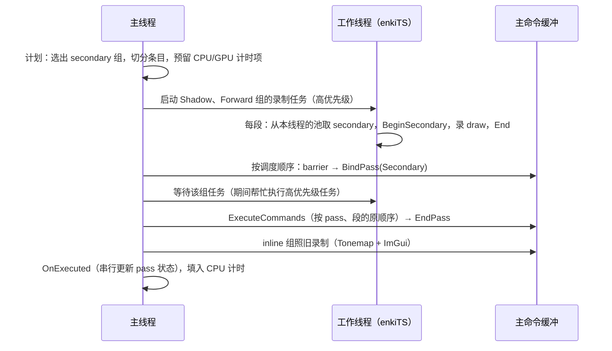

# 阶段 3 剩余工作实现计划：异步上传与并行录制

阶段 3（Roadmap 3.1，对应 Raptor 第 3 章）已完成线程池（enkiTS）和异步场景加载（`152c2da`），并有了逐 pass 的 CPU / GPU 计时（`abaeff8`）。本计划覆盖剩下的部分：

- **加载收尾**：上传不再在 CPU 上等 fence；加载中切换场景不再阻塞主线程。
- **并行录制**：Forward 与 Shadow 的 draw 分段，在工作线程上录进 secondary command buffer，由主命令缓冲执行。

## 1. 现状测量

桌面 Release，1280×720，20 个硬件线程。录制和 GPU 时间取 Profiler 面板的 120 帧平均（Shadow 只在重绘时有样本）。

| 场景 | 可见 draw | Forward 录制 | Shadow 录制 | Frame Graph 录制合计 | Forward GPU |
| --- | --- | --- | --- | --- | --- |
| Sponza | 39 / 103 | 0.044 ms | 0.061 ms | 0.10 ms | 2.87 ms |
| Bistro | 2183 / 2570 | 0.79 ms | 0.48 ms | 0.86 ms | 7.63 ms |

| 场景 | 上传更新次数 | 单次更新最长阻塞 |
| --- | --- | --- |
| Sponza | 10 | 780 ms |
| Bistro | 62 | 527 ms |

结论：

1. **上传阻塞是当前最大的卡顿**。每次上传都在 CPU 上等 fence，而图形队列只有一个，等的是此前提交的所有帧。自动化环境里呈现被节流，数字偏大，但无论实际是几十还是几百毫秒，它都直接表现为掉帧。Roadmap 的设计本来就是“靠帧 fence 判断完成”。
2. **并行录制在桌面上收益有限，在手机上有意义**。Bistro 桌面上省下的上限约 0.8 ms。手机 CPU 的单线程性能约为桌面的 1/3–1/5，同样的录制大约要 2.5–4 ms，占 16.7 ms 帧预算的 15–25%。阶段 8（GPU 驱动渲染）之前，这是降低大场景 CPU 开销的唯一手段。
3. 小场景（DamagedHelmet、Sponza）录制不到 0.1 ms，分段只会增加开销，所以要设阈值：draw 少时保持现在的 inline 录制。

## 2. 目标与不做的事

**目标**

- 场景加载期间没有超过一帧的阻塞（上传和取消都不在 CPU 上等 GPU 或解析任务）。
- Bistro 的 Forward + Shadow 录制按 draw 分段并行，结果与 inline 录制逐条一致（draw 顺序不变）。
- 小场景自动走 inline 路径；并行录制可以在面板上开关，便于对比。
- Profiler 面板继续给出每个 pass 的 CPU / GPU 时间，并行的 pass 显示任务数。
- 同步校验层无报错；Android 上验证（需要真机环境）。

**不做**（理由见第 3 节 D1、D2）

- 资源池加锁、任意线程创建资源（Review P1-1 的加锁方案）。
- barrier 改由 Frame Graph 编译期生成（Review P1-2）。
- `FrameContext`（P1-4）与动态 uniform 环的原子化（P1-5），留作 P3 整理。
- 独立 transfer 队列：T0 只有一个队列。
- compute 节点并行录制：目前没有重的 compute 节点。

## 3. 设计决定

| 编号 | 决定 | 理由 |
| --- | --- | --- |
| D1 | **fork-join 并行录制**：主线程发起录制任务并等待它们完成；这段时间里主线程不创建、不销毁资源。`GpuDevice` 用一个“并行录制中”标志，让所有创建 / 销毁 / 上传 / 提交入口在此期间断言失败 | 工作线程只读资源池（`Access*`）。只要没有并发写，`std::vector<bool>` 位压缩和槽位立即复用都不会出问题，因此不需要加锁 |
| D2 | **barrier 和 render pass 的开始 / 结束仍由主线程在主命令缓冲里串行录制**，工作线程只录 render pass 内部的 secondary | secondary 在 render pass 内，本来就不能录 barrier；纹理状态只在主线程上按调度顺序改写，录制顺序仍等于执行顺序，P1-2 的问题不出现 |
| D3 | **整组切换**：一个合并组只有一个 subpass，要么全部 inline，要么全部 secondary。只要组里有 pass 的可并行条目数 ≥ `2 × minItemsPerTask`（默认 128），这个组就用 secondary。组里不能拆分的 pass（Skybox、DebugDraw）各录成一个 secondary | Vulkan 规定一个 subpass 不能混用 inline 与 secondary 内容（`VK_SUBPASS_CONTENTS_SECONDARY_COMMAND_BUFFERS`） |
| D4 | **只能在主线程录制的 pass**（ImGui：后端在录制时会创建、扩容自己的 buffer）声明 `RecordsOnMainThread()`，它所在的组永远走 inline | ImGui 后端不是线程安全的 |
| D5 | **每个线程、每个帧槽一个命令池**。secondary 从录制它的线程自己的池里分配（每个池只被它的线程访问），主线程在 `BeginFrame` 等过 fence 后统一重置 | 与 Raptor 一致；enkiTS 运行时才决定任务落在哪个线程，所以 secondary 只能在工作线程上按 `threadnum` 分配 |
| D6 | **先启动、后组装**：`FrameGraph::Execute` 先为所有 secondary 组启动录制任务（Shadow 与 Forward 同时录），再按调度顺序串行组装主命令缓冲；组装到某组时才等待该组的任务 | 多个组的录制可以重叠，主线程等待时也在执行任务 |
| D7 | **录制任务用高优先级，加载任务用低优先级**；主线程等待时只帮忙执行高优先级任务（`WaitforTask(task, TASK_PRIORITY_HIGH)`） | 否则主线程可能在等待时接手一个几十毫秒的纹理解码任务，造成掉帧 |
| D8 | **计时项在计划阶段按调度顺序整帧预留**：GPU 和 CPU profiler 都新增“预留 scope / 写入开始 / 写入结束（或时长）”接口，录制线程只往预留好的 query 里写；Frame Graph 不再使用全局栈式的 `Push` / `Pop` | 全局 scope 栈在多个命令缓冲上会乱（Review P1-10）；整帧统一预留，结果顺序就与调度顺序一致，inline 组和 secondary 组之间也不会错位 |
| D9 | 一个 pass 被分成多段时：GPU 时间取第一段开始到最后一段结束；CPU 时间取各段录制时间之和（即总工作量），组这一行的 CPU 取墙钟时间 | 两种 CPU 时间都有用：总工作量看负载，墙钟看实际帧开销 |
| D10 | **上传改为提交后不等待**：批次轮流使用 3 个上传槽（命令池、fence、24 MB staging 段），只在复用仍在途的槽时等待；`SceneLoader` 每帧一个不跨槽的批次（`UploadBatchHasRoomFor`）。不需要 ticket，所有上传都走同一条路径 | 同一队列按提交顺序执行：批次末尾的 barrier 覆盖后续帧的读取，帧 fence 覆盖更早的批次，所以现有的按帧号延迟销毁仍然正确。上一个批次可能排在一个等待交换链图像的帧后面，复用它的槽就要等呈现，所以至少 3 个槽 |
| D11 | **取消加载不等待**：解析和解码任务持有各自的数据；取消时把任务移进“孤儿”列表，`Update` 每帧回收已完成的任务，`Shutdown` 时才等待 | tinygltf 解析不可中断（Bistro 约 15 秒） |

## 4. 帧内流程（并行录制）

## 5. 分步实现

按两条线推进，互不依赖：A 线（加载收尾）收益最直接；B 线（并行录制）分 5 步。每一步单独提交，提交前 Debug 零警告、开同步校验运行四个场景无报错。

### A1 上传不在 CPU 上等待（D10，Review P1-6）——**已完成**

- 实现比原计划简单：没有 ticket，也没有同步 / 异步两套批次（见 D10 的理由）。
  - `GpuDevice`：3 个上传槽，提交后不等待；复用在途的槽时才等它的 fence；`BeginFrame` 与 `WaitIdle` 回收已完成的槽。
  - `UploadBatchHasRoomFor(bytes)`：`SceneLoader` 和 `GltfSceneUploader::UploadBuffers` 用它把一次更新控制在一个槽内；`Finish`（材质常量）并入最后一次更新的批次。
  - 修正：`UploadTexture` 先取 staging 再取命令缓冲（取 staging 可能提交并换槽）。
- 第一版只有 2 个槽、一次更新可以跨槽：等待从数百毫秒降到约 10–20 ms，但每次跨槽仍会等上一个批次，它排在等待交换链图像的帧后面。改为 3 个槽并且不跨槽后，测量期间没有再出现超过 5 ms 的等待。
- **结果**（Release，单帧最长上传更新）：

  | 场景 | 改动前 | 改动后 |
  | --- | --- | --- |
  | Sponza | 780 ms | 8.1 ms |
  | Bistro | 527 ms | 16.3 ms |

  剩下的时间是 CPU 上的 memcpy 和命令录制。四个场景开同步校验运行无报错，加载结果不变；Sponza 上传中切到 Bistro、Bistro 上传中退出都正常。

### A2 取消加载不等待（D11，Review P1-9 遗留）

- `SceneLoader` 的解析、解码任务对象改为 `std::unique_ptr`，任务持有输入数据（路径、`GltfSceneData` 的共享所有权）。
- `Cancel()`：把在途任务移进 `m_orphans`，立即返回；`Update()` 回收已完成的孤儿；`Shutdown()` 等待全部。
- 加载任务设为低优先级（D7）。
- **验证**：Bistro 解析中切到 Sponza，切换立即生效（Sponza 与 Bistro 的解析并行）；连续快速切换；解析中退出。

### B1 RHI：secondary command buffer 与每线程命令池（D5，Review P1-3）

- `GpuDeviceCreation::recordingThreadCount`（由 `Application` 传入 enkiTS 的线程数，设备本身不依赖 enkiTS）。`FrameData` 增加每线程的命令池和 secondary 列表；`BeginFrame` 重置当前帧槽的所有线程池。
- `GpuDevice::BeginParallelRecording()` / `EndParallelRecording()`：设置 D1 的标志；`AssertOwnerThread` 同时断言不在并行录制中。
- `CommandBuffer GpuDevice::AcquireSecondary(uint32_t threadIndex)`：任意线程，只访问该线程自己的池；只允许在并行录制期间调用。
- `CommandBuffer`：
  - `BeginSecondary(RenderPassHandle)`：继承 render pass、subpass 0 和 framebuffer，`RENDER_PASS_CONTINUE`；设置视口和裁剪（secondary 不继承动态状态）；`End()`。
  - `BindPass(handle, SubpassContents)`；`ExecuteCommands(std::span<const VkCommandBuffer>)`。
  - 断言：secondary 里不能 `Barrier` / `BindPass` / `EndPass` / `PushTimestamp`；以 secondary 内容开始的 subpass 里，主命令缓冲不能 draw。
- **验证**：在 Forward 组上临时强制 secondary 模式（单线程录制），画面与 inline 一致，校验层无报错。

### B2 计时项预留（D8、D9，Review P1-10）

- `GpuProfiler`：`ScopeId ReserveScope(name, depth)`（主线程）、`WriteBegin(VkCommandBuffer, id)` / `WriteEnd(...)`（任意线程，只写预留好的 query）。保留 `Push` / `Pop` 给 Frame Graph 之外的调用者。
- `CpuProfiler`：`ReserveScope(name, depth)`，`SetDuration(id, ns)`；`ScopeTiming` 增加 `taskCount`（并行段数，inline 为 0）。
- `FrameGraph::Execute` 的计划阶段先为整帧预留计时项；inline 路径改用预留接口，结果与现在一致。
- `ProfilerPanel`：并行的 pass 在名字后显示 `×N`，悬停说明 CPU 是各段之和。
- **验证**：inline 路径下，Profiler 面板的行、层级、数值与 `abaeff8` 一致。

### B3 Pass 并行接口与公共 draw 循环（Review P1-7 剩余、P3-5）

- `FrameGraphPass` 新增：
  - `uint32_t ParallelItemCount(const RenderView&) const`（默认 0：不可拆分）；
  - `void ExecuteRange(FrameGraphContext&, uint32_t first, uint32_t count)`；
  - `bool RecordsOnMainThread() const`（默认 false；`ImGuiPass` 为 true）；
  - `void OnExecuted(const RenderView&)`：主线程，在本帧录制全部完成后调用。
- 契约：`Execute` / `ExecuteRange` 可能在任意线程上并发运行，只读场景和自身成员，不能读其他 pass 在同一帧 `Execute` 中写入的状态。
- 新增 `passes/SceneDrawing.hpp`：`DrawSceneItems(commandBuffer, scene, drawIndices, pipelines, keyMask, materialPolicy)`，Forward 与 Shadow 共用。每次调用都从“无绑定”状态开始（secondary 本来就不继承绑定）。
- `ShadowPass`：`m_dirty` / `m_rendered` 等状态更新移到 `OnExecuted`；两个 pass 的“缺失变体只报告一次”标志改为 `std::atomic<bool>`。
- **验证**：纯重构，inline 路径下画面、Profiler 数值不变。

### B4 Frame Graph 三段式执行（D2、D3、D6、D7）

- `FrameGraph::Init` 接收 `enki::TaskScheduler&`；`ParallelRecordingSettings { bool enabled; uint32_t minItemsPerTask = 128; }`。
- **计划**（主线程）：对每个调度项，按 D3 / D4 决定组的模式；secondary 组生成录制任务列表 `(组, 节点, first, count)`。每个 pass 的段数 = `min(ceil(items / minItemsPerTask), 线程数)`；不可拆分的 pass 一段。预留计时项。
- **启动**：`BeginParallelRecording()`；每个 secondary 组一个 `ITaskSet`（高优先级），`SetSize` = 段数，每个元素按 `threadnum` 取 secondary、录制、记 CPU 时长，结果写进按段编号的数组。
- **组装**（主线程）：按调度顺序走；secondary 组：`RecordBarriers` → 清屏值 → `BindPass(Secondary)` → `WaitforTask(组任务, TASK_PRIORITY_HIGH)` → `ExecuteCommands`（段的原顺序）→ `EndPass`；inline 组与 compute 节点不变。
- **收尾**：`EndParallelRecording()`；所有执行过的 pass 调用 `OnExecuted`；填入 CPU 时长。
- 异常：录制任务内的异常先捕获并保存，等待完成后在主线程重新抛出。
- **验证**：
  - Bistro 并行与 inline 的画面一致：RenderDoc 对比 draw 数和顺序，或临时回读 HDR 目标逐像素比较。
  - 同步校验层无报错；连续切换场景、改变窗口大小（图重新编译）、切换开关。
  - Profiler：Bistro Forward 组的墙钟 CPU 时间，桌面目标 < 0.3 ms（目前 0.82 ms）。

### B5 开关、文档与 Android

- `RenderSettings` 增加并行录制开关和 `minItemsPerTask`，放在 Frame Graph 面板。
- 文档：`Architecture.md` 第 8 节（线程）写明 D1 的契约和可从工作线程调用的接口清单，5.5 节（Frame Graph）写三段式执行；`Roadmap.md` 把阶段 3 标为完成并补上决定表；`Review.md` 更新 P1-1 到 P1-10 的状态（P1-1、P1-2、P1-4、P1-5 记为“fork-join 下不需要”，并写明理由）。
- Android：真机运行 Sponza 和 Bistro，记录 inline 与并行两种模式的录制时间；确认 secondary 在 Mali / Adreno 上没有额外的 GPU 开销（tiler 上 `vkCmdExecuteCommands` 的代价因驱动而异）。如果某些驱动变慢，把阈值调高或按设备默认关闭。**需要可以运行 Gradle 和连接真机的环境。**

## 6. 风险

| 风险 | 应对 |
| --- | --- |
| 分段开销（每个 secondary 的 begin / end、重复的管线和描述符绑定）抵消收益 | `minItemsPerTask` 阈值；Profiler 对比两种模式；段数不超过线程数 |
| 主线程等待时接手长任务 | D7 的优先级；加载任务全部为低优先级 |
| 某个 pass 在 `Execute` 里悄悄写共享状态 | B3 的契约 + 把已知写入移到 `OnExecuted`；Debug 下可以临时用 2 个线程、每段 1 个 draw 做压力测试 |
| 驱动对 secondary 的支持问题（继承的 framebuffer、timestamp） | 继承信息完整填写；校验层；开关可以随时退回 inline |
| 上传 ticket 化后，资源在 GPU 完成前被销毁 | 延迟销毁按 ticket 判断；加载中切换场景、退出都要测 |

## 7. 推迟到之后的阶段

- `FrameContext`、`Access*` 返回 const（P1-4），并入 P3-1 的 `GpuDevice` 拆分。
- 动态 uniform 环按线程分块（P1-5）：GPU 驱动渲染（阶段 8）需要每 draw 数据进 storage buffer 时再做。
- barrier 编译期生成（P1-2）：异步计算（阶段 9）引入多队列时再做。
